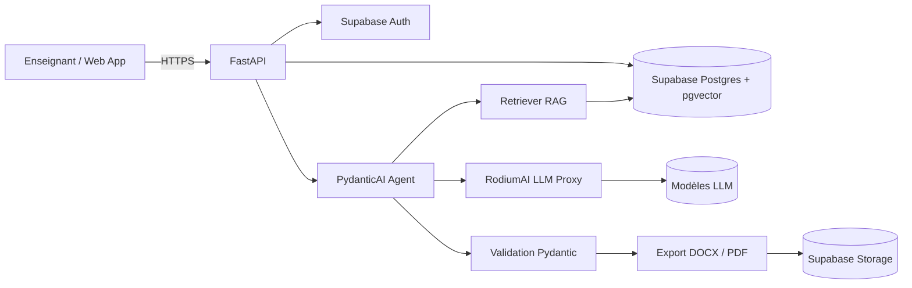
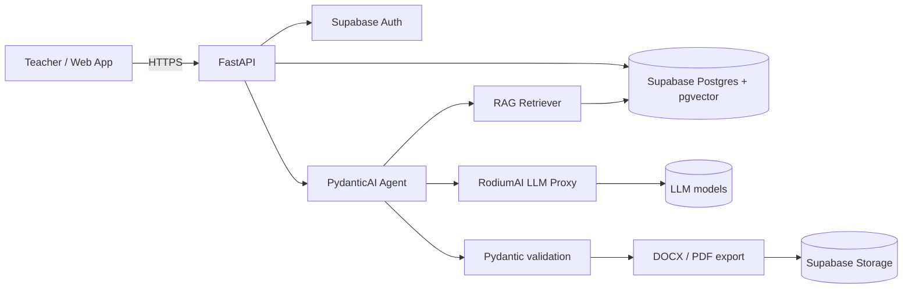

# pedago-ai

> Générateur de fiches de préparation et de guides d'exécution pédagogique assisté par IA (RAG), aligné sur l'Approche Par Compétences (APC).
> AI-assisted pedagogical lesson plan generator (RAG), aligned with the Competency-Based Approach (APC).

[](#roadmap)
[](#licence--license)

---

## Sommaire / Table of contents

1. [Français](#-version-française)
2. [English](#-english-version)

---

# 🇫🇷 Version française

## Présentation

**pedago-ai** est une plateforme SaaS qui aide les enseignants de l'enseignement primaire et secondaire, en particulier en Afrique de l'Ouest (Togo en premier lieu), à produire rapidement des **fiches de préparation de leçon** et des **guides d'exécution pédagogique** conformes à l'**APC (Approche Par Compétences)**.

Le système s'appuie sur une architecture **RAG (Retrieval-Augmented Generation)** :

- les **programmes officiels** et référentiels de compétences sont indexés et recherchés sémantiquement ;
- des **fiches pédagogiques de référence** (few-shot) servent d'exemples de structure, de ton et de niveau ;
- un **LLM** (accédé via un proxy **RodiumAI**) génère une fiche structurée, validée par schéma, puis exportée en **DOCX** et **PDF**.

### Fonctionnalités clés

- Génération de fiche de préparation (objectifs, compétences ciblées, prérequis, déroulement, évaluation, matériel).
- Génération de **guides d'exécution pédagogique** (séquences, consignes, gestion du temps, différenciation).
- Alignement explicite sur les **compétences, situations de vie et savoirs** de l'APC.
- Modularité **primaire / secondaire** : niveaux, disciplines et référentiels configurables.
- Conformité **IESG** et paramétrage national (Togo et au-delà) via des profils de référentiel.
- Export **DOCX** et **PDF** avec mise en page institutionnelle.
- Espace enseignant (compte, bibliothèque de fiches, historique de versions).
- Architecture multi-tenant prête pour une offre SaaS (écoles, réseaux, formateurs).

## Architecture



### Pipeline RAG

1. **Ingestion** : parsing des programmes, référentiels APC et fiches de référence (PDF, DOCX), découpage par compétence / situation / section.
2. **Embeddings** : vectorisation des chunks et stockage dans `pgvector`, avec métadonnées (niveau, discipline, référentiel, pays, version).
3. **Récupération** : recherche hybride (similarité vectorielle + filtres métadonnées) sur le référentiel ciblé.
4. **Few-shot** : sélection de 1 à 3 fiches de référence proches (même niveau / discipline) injectées dans le prompt.
5. **Génération** : PydanticAI produit un objet typé `LessonPlan` via le proxy RodiumAI.
6. **Validation** : schéma Pydantic, contrôle de cohérence (compétence ↔ objectifs ↔ évaluation), réessai borné.
7. **Export** : rendu DOCX / PDF à partir du modèle validé.

### Stack technique

| Couche | Technologie |
|---|---|
| API | FastAPI (Python 3.12+) |
| Agents / sorties structurées | PydanticAI |
| Base de données & vecteurs | Supabase Postgres + pgvector |
| Authentification | Supabase Auth |
| Fichiers | Supabase Storage |
| LLM | RodiumAI (proxy, modèles interchangeables) |
| Export | python-docx, WeasyPrint ou Typst (PDF) |
| Frontend | Application web (TanStack Start / React recommandé) |
| Qualité | pytest, ruff, mypy, pre-commit |
| CI/CD | GitHub Actions |

## Structure du dépôt (prévue)

```
pedago-ai/
├── apps/
│   ├── api/                  # FastAPI : routes, dépendances, configuration
│   └── web/                  # Interface enseignant
├── packages/
│   ├── core/                 # Domaine : modèles LessonPlan, Competency, Level...
│   ├── rag/                  # Ingestion, chunking, embeddings, retrieval
│   ├── agents/               # Agents PydanticAI et prompts versionnés
│   ├── llm/                  # Client RodiumAI (proxy) et abstraction modèle
│   └── export/               # Rendu DOCX / PDF
├── data/
│   ├── referentiels/         # Référentiels APC par pays / niveau / discipline
│   └── fiches_reference/     # Fiches few-shot validées
├── supabase/
│   ├── migrations/           # Schéma SQL, pgvector, RLS
│   └── seed/
├── docs/                     # Architecture, ADR, guides
├── tests/
├── .github/workflows/        # CI
├── .env.example
└── README.md
```

## Démarrage rapide

### Prérequis

- Python 3.12+ et `uv` (ou `pip`)
- Node.js 20+ et pnpm (pour l'interface web)
- Un projet Supabase (avec l'extension `vector` activée)
- Une clé API RodiumAI

### Installation

```bash
git clone https://github.com/justin2119/pedago-ai.git
cd pedago-ai
cp .env.example .env          # renseigner les variables
uv sync                       # dépendances Python
uv run pre-commit install
uv run uvicorn apps.api.main:app --reload
```

### Variables d'environnement

| Variable | Description |
|---|---|
| `SUPABASE_URL` | URL du projet Supabase |
| `SUPABASE_ANON_KEY` | Clé publique (côté client) |
| `SUPABASE_SERVICE_ROLE_KEY` | Clé serveur (jamais exposée au navigateur) |
| `SUPABASE_DB_URL` | Connexion Postgres |
| `RODIUM_API_KEY` | Clé du proxy RodiumAI |
| `RODIUM_BASE_URL` | URL du proxy RodiumAI |
| `RODIUM_MODEL` | Modèle par défaut |
| `EMBEDDING_MODEL` | Modèle d'embeddings |
| `DEFAULT_COUNTRY` | Pays de référentiel par défaut (ex. `TG`) |
| `APP_ENV` | `dev`, `staging`, `prod` |

## API (aperçu)

Toutes les routes sont préfixées par `/api/v1` et protégées par un jeton Supabase (`Authorization: Bearer <jwt>`).

| Méthode | Route | Description |
|---|---|---|
| `POST` | `/lesson-plans` | Génère une fiche de préparation |
| `POST` | `/execution-guides` | Génère un guide d'exécution pédagogique |
| `GET` | `/lesson-plans/{id}` | Récupère une fiche |
| `PATCH` | `/lesson-plans/{id}` | Modifie une fiche (nouvelle version) |
| `GET` | `/lesson-plans/{id}/export?format=docx\|pdf` | Exporte la fiche |
| `GET` | `/referentiels?country=TG&level=secondaire` | Liste les référentiels disponibles |
| `GET` | `/reference-sheets?discipline=...` | Liste les fiches de référence |
| `POST` | `/admin/ingest` | Ingestion d'un référentiel (rôle admin) |

### Exemple de requête

```json
POST /api/v1/lesson-plans
{
  "country": "TG",
  "level": "secondaire",
  "class": "6e",
  "discipline": "Mathématiques",
  "competency_code": "<code tiré du référentiel>",
  "topic": "Les fractions",
  "duration_minutes": 55,
  "language": "fr"
}
```

### Schéma de sortie (extrait)

```python
class LessonPlan(BaseModel):
    title: str
    level: Level
    discipline: str
    competency_code: str
    objectives: list[LearningObjective]
    prerequisites: list[str]
    materials: list[str]
    phases: list[LessonPhase]      # introduction, développement, synthèse, évaluation
    assessment: AssessmentCriteria
    sources: list[SourceRef]       # traçabilité RAG
```

## Modèle de données (aperçu)

- `countries`, `referentials` (pays, niveau, version, IESG / profil national)
- `competencies`, `situations`, `knowledge_items` (hiérarchie APC)
- `document_chunks` (`embedding vector(...)`, métadonnées, index HNSW)
- `reference_sheets` (fiches few-shot validées)
- `lesson_plans`, `lesson_plan_versions`, `exports`
- `organizations`, `memberships` (multi-tenant, RLS Supabase)

## Qualité, sécurité et conformité

- Row Level Security activée sur toutes les tables utilisateur.
- Aucune donnée personnelle d'élève n'est requise ; minimisation des données.
- Clés API uniquement côté serveur ; secrets gérés par variables d'environnement.
- Journalisation des appels LLM (sans contenu sensible) pour audit et coûts.
- Contrôle humain : chaque fiche générée est éditable et doit être validée par l'enseignant.
- Tests : unitaires (schémas, chunking), intégration (RAG, export), évaluation de qualité des fiches (grille de relecture).

## Feuille de route / Roadmap

- **Phase 0 : Fondations** : dépôt, CI, schéma Supabase, ingestion d'un premier référentiel.
- **Phase 1 : MVP** : génération de fiches (secondaire, une discipline), export DOCX / PDF.
- **Phase 2 : Guides d'exécution** et bibliothèque de fiches de référence.
- **Phase 3 : Primaire**, profils IESG et paramétrage multi-pays.
- **Phase 4 : SaaS** : comptes établissements, facturation, quotas, tableau de bord.
- **Phase 5 : Qualité** : boucle de retour enseignants, évaluation automatique des fiches.

## Contribuer

Les contributions sont bienvenues : ouvrez d'abord une issue pour discuter d'un changement majeur. Respectez les conventions de commit (Conventional Commits) et lancez `uv run pytest` et `uv run ruff check` avant chaque pull request.

## Licence / License

Licence à définir par le titulaire du dépôt. Tant qu'aucune licence n'est publiée, tous droits sont réservés.

---

# 🇬🇧 English version

## Overview

**pedago-ai** is a SaaS platform that helps primary and secondary school teachers, especially in West Africa (starting with Togo), produce **lesson plans** and **pedagogical execution guides** aligned with the **APC (Competency-Based Approach)**.

The system is built on **Retrieval-Augmented Generation (RAG)**:

- official curricula and competency frameworks are indexed and searched semantically;
- **few-shot reference sheets** provide structure, tone and level examples;
- an **LLM** (accessed through a **RodiumAI** proxy) generates a schema-validated plan, exported to **DOCX** and **PDF**.

### Key features

- Lesson plan generation (objectives, targeted competencies, prerequisites, lesson flow, assessment, materials).
- Pedagogical **execution guides** (sequences, instructions, timing, differentiation).
- Explicit alignment with APC **competencies, life situations and knowledge items**.
- **Primary / secondary** modularity: configurable levels, disciplines and frameworks.
- **IESG** compliance and national configuration (Togo and beyond) through framework profiles.
- **DOCX** and **PDF** export with institutional layout.
- Teacher workspace (accounts, sheet library, version history).
- Multi-tenant architecture ready for a SaaS offering (schools, networks, trainers).

## Architecture



### RAG pipeline

1. **Ingestion**: parse curricula, APC frameworks and reference sheets (PDF, DOCX), chunk by competency / situation / section.
2. **Embeddings**: vectorize chunks into `pgvector` with metadata (level, discipline, framework, country, version).
3. **Retrieval**: hybrid search (vector similarity + metadata filters) on the target framework.
4. **Few-shot**: select 1 to 3 close reference sheets (same level / discipline) for the prompt.
5. **Generation**: PydanticAI returns a typed `LessonPlan` through the RodiumAI proxy.
6. **Validation**: Pydantic schema plus consistency checks (competency, objectives and assessment must agree), bounded retries.
7. **Export**: DOCX / PDF rendering from the validated model.

### Tech stack

| Layer | Technology |
|---|---|
| API | FastAPI (Python 3.12+) |
| Agents / structured output | PydanticAI |
| Database & vectors | Supabase Postgres + pgvector |
| Auth | Supabase Auth |
| Files | Supabase Storage |
| LLM | RodiumAI (proxy, swappable models) |
| Export | python-docx, WeasyPrint or Typst (PDF) |
| Frontend | Web app (TanStack Start / React recommended) |
| Quality | pytest, ruff, mypy, pre-commit |
| CI/CD | GitHub Actions |

## Planned repository layout

See the French section above for the directory tree.

## Quick start

```bash
git clone https://github.com/justin2119/pedago-ai.git
cd pedago-ai
cp .env.example .env
uv sync
uv run pre-commit install
uv run uvicorn apps.api.main:app --reload
```

Required environment variables: `SUPABASE_URL`, `SUPABASE_ANON_KEY`, `SUPABASE_SERVICE_ROLE_KEY`, `SUPABASE_DB_URL`, `RODIUM_API_KEY`, `RODIUM_BASE_URL`, `RODIUM_MODEL`, `EMBEDDING_MODEL`, `DEFAULT_COUNTRY`, `APP_ENV`.

## API (overview)

Routes are prefixed with `/api/v1` and protected by a Supabase JWT (`Authorization: Bearer <jwt>`).

| Method | Route | Description |
|---|---|---|
| `POST` | `/lesson-plans` | Generate a lesson plan |
| `POST` | `/execution-guides` | Generate a pedagogical execution guide |
| `GET` | `/lesson-plans/{id}` | Fetch a plan |
| `PATCH` | `/lesson-plans/{id}` | Edit a plan (new version) |
| `GET` | `/lesson-plans/{id}/export?format=docx\|pdf` | Export a plan |
| `GET` | `/referentiels?country=TG&level=secondaire` | List available frameworks |
| `GET` | `/reference-sheets?discipline=...` | List few-shot reference sheets |
| `POST` | `/admin/ingest` | Ingest a framework (admin role) |

## Data model (overview)

`countries`, `referentials`, `competencies`, `situations`, `knowledge_items`, `document_chunks` (pgvector, HNSW index), `reference_sheets`, `lesson_plans`, `lesson_plan_versions`, `exports`, `organizations`, `memberships` (multi-tenant with Supabase RLS).

## Security and compliance

- Row Level Security on all user-owned tables.
- No student personal data required; data minimization by default.
- API keys stay server-side only.
- LLM calls are logged without sensitive content, for audit and cost tracking.
- Human in the loop: every generated plan is editable and must be reviewed by the teacher.

## Roadmap

- **Phase 0, Foundations**: repository, CI, Supabase schema, first framework ingestion.
- **Phase 1, MVP**: lesson plans for secondary school (one discipline), DOCX / PDF export.
- **Phase 2**: execution guides and reference sheet library.
- **Phase 3**: primary school, IESG profiles, multi-country configuration.
- **Phase 4, SaaS**: school accounts, billing, quotas, dashboard.
- **Phase 5, Quality**: teacher feedback loop, automated plan evaluation.

## Contributing

Open an issue before any major change. Use Conventional Commits and run `uv run pytest` and `uv run ruff check` before each pull request.

## License

To be defined by the repository owner. Until a license is published, all rights are reserved.
