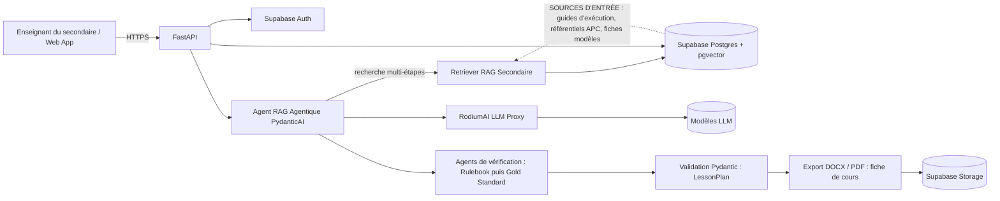
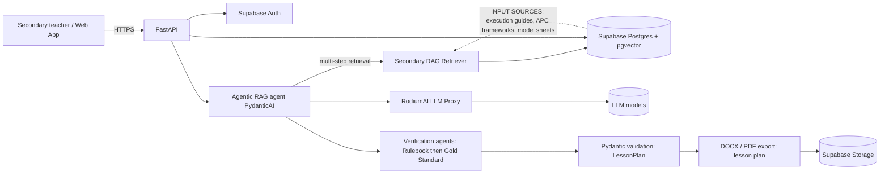

# pedago-ai

> Générateur de **fiches de cours (fiches de préparation de leçon)** APC, assisté par un **RAG Agentique** (PydanticAI), à destination des enseignants du **Collège** (Secondaire 1) et du **Lycée** (Secondaire 2).
> APC-compliant **lesson plan (fiche de cours)** generator powered by an **Agentic RAG** (PydanticAI), for **Collège** (Secondaire 1) and **Lycée** (Secondaire 2) teachers.

[](#feuille-de-route--roadmap)
[](#licence--license)

> **Périmètre clé / Key scope** : pedago-ai produit UNIQUEMENT des fiches de cours (fiches de préparation). Il ne génère JAMAIS de guides d'exécution pédagogique. Les guides d'exécution et les fiches modèles sont des SOURCES d'entrée pour le RAG Agentique.
> **Key scope**: pedago-ai produces ONLY lesson plans (fiches de cours). It NEVER generates pedagogical execution guides. Execution guides and model sheets are INPUT SOURCES for the Agentic RAG.

---

## Sommaire / Table of contents

1. [Français](#-version-française)
2. [English](#-english-version)

---

# 🇫🇷 Version française

## Présentation

**pedago-ai** est une plateforme SaaS qui aide les enseignants de l'**enseignement secondaire** (Collège et Lycée), en particulier en Afrique de l'Ouest (Togo en premier lieu), à produire rapidement des **fiches de cours (fiches de préparation de leçon)** conformes à l'**APC (Approche Par Compétences)**.

**Produit unique du SaaS** : la génération de fiches de cours pédagogiques (fiches de préparation), APC-compliant, pour les enseignants du Collège et du Lycée.

**Ce que pedago-ai ne fait PAS** : il ne génère pas de guides d'exécution pédagogique. Les **Guides d'exécution pédagogique du secondaire** et les **fiches modèles étalons** sont des **sources d'entrée** (documents de référence et de contexte) consommées par le moteur RAG Agentique ; ils ne sont jamais produits par le système.

Le générateur est **exclusivement dédié au secondaire**. Il ne couvre pas l'enseignement primaire.

| Niveau | Classes couvertes | Séries / filières |
|---|---|---|
| **Secondaire 1 (Collège)** | 6ème, 5ème, 4ème, 3ème | Tronc commun |
| **Secondaire 2 (Lycée)** | Seconde, Première, Terminale | Seconde A, C, CD, S ; Première A4, C, D ; Terminale A4, C4, D, CD |

### Énoncé du problème

Les enseignants du secondaire doivent préparer des fiches de cours conformes à l'APC, c'est-à-dire alignées sur les compétences terminales, les situations d'apprentissage autorisées et les règles du Guide d'exécution officiel, tout en respectant la structure et le style des fiches validées par les conseillers pédagogiques et les inspecteurs. Cette préparation est longue, et il est difficile de retrouver manuellement, pour chaque classe, série et discipline, le bon extrait de référentiel et la bonne fiche modèle.

pedago-ai résout ce problème en produisant, à partir d'une demande d'enseignant (classe, série, discipline, code de compétence, thème, durée), une **fiche de cours** structurée, sourcée et validée. Les guides d'exécution et les fiches modèles servent de **matière première documentaire** au moteur, pas de produit.

### Moteur : RAG Agentique

Le moteur est un **RAG Agentique** (Retrieval-Augmented Generation agentique), et non un RAG linéaire à une seule passe. Des agents **PydanticAI** exécutent plusieurs étapes successives :

- **Recherche multi-étapes** : l'agent décide quelles sources interroger (guide d'exécution, référentiel APC, fiches modèles), reformule ses requêtes et peut relancer une recherche si les extraits sont insuffisants ;
- **Ancrage (grounding)** : chaque élément de contenu de la fiche doit être justifié par un extrait source ;
- **Vérification** : des agents de contrôle vérifient la conformité au Guide d'exécution (règle prioritaire) puis au style des fiches modèles, avec réessai borné ;
- **Génération structurée** : la fiche finale est un objet typé `LessonPlan`, validé par schéma Pydantic.

Le système s'appuie sur :

- les **Guides d'exécution pédagogique du secondaire** (Collège & Lycée) et les référentiels de compétences APC, indexés et recherchés sémantiquement, comme **sources d'entrée** ;
- des **fiches modèles étalons** (few-shot), utilisées comme **exemples de structure, de ton et de niveau**, comme **contexte d'entrée** ;
- un **LLM** (accédé via un proxy **RodiumAI**) qui produit la fiche de cours, puis export en **DOCX** et **PDF**.

### Fonctionnalités clés

- Génération de **fiches de cours (fiches de préparation)** pour le Collège (6ème à 3ème) et le Lycée (Seconde, Première, Terminale), toutes séries confondues.
- Alignement explicite sur les **compétences, situations de vie et savoirs** de l'APC, avec un référentiel distinct pour le Collège et pour le Lycée.
- Prise en compte des **séries du Lycée** (Seconde A, C, CD, S ; Première A4, C, D ; Terminale A4, C4, D, CD) et des disciplines propres à chaque série.
- **Double ancrage** : contrainte légale par le Guide d'Exécution (Rulebook, source d'entrée) et référence stylistique par les fiches modèles étalons (Few-Shot Gold Standard, source d'entrée), voir ci-dessous.
- Conformité **IESG** et paramétrage national (Togo et au-delà) via des profils de référentiel.
- Export **DOCX** et **PDF** avec mise en page institutionnelle (fiche de cours du secondaire).
- Espace enseignant (compte, bibliothèque de fiches par classe et série, historique de versions).
- Architecture multi-tenant prête pour une offre SaaS (collèges, lycées, réseaux, formateurs).

## Architecture



La seule sortie du système est la **fiche de cours**. Les guides d'exécution et les fiches modèles n'apparaissent dans le diagramme qu'en tant que sources d'entrée du RAG Agentique.

### Pipeline RAG Agentique

1. **Ingestion** (sources d'entrée) : parsing des Guides d'exécution pédagogique du secondaire (Collège & Lycée), des référentiels APC et des fiches modèles étalons (PDF, DOCX), découpage par classe / série / compétence / situation / section.
2. **Embeddings** : vectorisation des chunks et stockage dans `pgvector`, avec métadonnées (niveau `secondaire`, classe, série, discipline, référentiel, pays, version).
3. **Planification agentique** : un agent PydanticAI analyse la demande (classe, série, discipline, compétence, thème, durée) et décide des requêtes de recherche à lancer dans chaque source.
4. **Récupération multi-étapes** : recherche hybride (similarité vectorielle + filtres métadonnées, dont la classe et la série), avec reformulation et nouvelle recherche si les extraits sont insuffisants.
5. **Few-shot** : sélection de 1 à 3 fiches modèles proches (même classe, même discipline, même série si applicable), injectées comme exemples de style.
6. **Génération structurée** : PydanticAI produit un objet typé `LessonPlan` (fiche de cours) via le proxy RodiumAI, chaque élément justifié par une source.
7. **Vérification** : contrôle Rulebook (durée, compétence, objectifs, prérequis, situations autorisées), puis contrôle Gold Standard (structure, formulation des OPO, vocabulaire), avec réessai borné ; validation Pydantic et cohérence (compétence ↔ objectifs ↔ évaluation).
8. **Export** : rendu DOCX / PDF de la fiche de cours validée. Aucun guide d'exécution n'est généré à aucune étape.

### Règle de conformité à double ancrage réglementaire et didactique : Rulebook et Few-Shot Gold Standard

Toute fiche de cours générée DOIT se conformer strictement et cumulativement à deux ancrages, tous deux issus de sources d'entrée et jamais produits par le système :

1. **Ancrage 1, le Guide d'Exécution Pédagogique officiel : le « Rulebook »**. C'est la norme légale et pédagogique : cadre réglementaire strict, programmes officiels, APC, compétences terminales, progressions annuelles, durée, prérequis et situations d'apprentissage imposées par le ministère. Il définit ce qui est obligatoire et ce qui est interdit. Aucune fiche de cours ne peut s'en écarter.
2. **Ancrage 2, le corpus de fiches modèles étalons : le « Few-Shot Gold Standard »**. Ce sont les fiches réelles validées par les conseillers pédagogiques et les inspecteurs IESG. Elles dictent la structure exacte, le style didactique, la formulation des objectifs pédagogiques opérationnels (OPO), et le découpage des activités enseignant / apprenant. Elles n'établissent jamais la légalité d'un contenu.

**Hiérarchie** : en cas de conflit, le Rulebook prime toujours sur le Gold Standard. Une fiche modèle qui contredit le Guide d'Exécution est écartée et signalée, même si elle est bien formatée.

**Architecture de récupération et de prompt du RAG Agentique** :

- **Étape A, Rulebook (filtre dur)** : récupération déterministe, et pas seulement sémantique, des extraits du Guide d'Exécution correspondant à la classe, à la série (le cas échéant), à la discipline et au code de compétence. Ces extraits sont injectés dans un bloc `[RULEBOOK]` présenté comme contraintes non négociables : compétence terminale, durée, prérequis, progression et situations d'apprentissage autorisées.
- **Étape B, Gold Standard (few-shot)** : 1 à 3 fiches modèles validées, sélectionnées d'abord par métadonnées (classe, série, discipline, type de fiche), puis par similarité sur le thème. Elles sont injectées dans un bloc `[GOLD_STANDARD]` présenté uniquement comme exemples de style, de structure et de vocabulaire.
- **Étape C, génération contrainte** : le LLM produit un `LessonPlan` typé (fiche de cours). Le prompt impose que chaque élément de contenu soit justifié par une source du Rulebook, et que le style soit imité du Gold Standard. Le champ `sources` distingue les références de type `rulebook` et `gold_standard`.
- **Étape D, vérification à deux passes** : (a) contrôle Rulebook : durée totale conforme au Guide, compétence et objectifs issus du référentiel, prérequis et progression respectés, situations autorisées. (b) contrôle Gold Standard : structure des phases, formulation des OPO, vocabulaire didactique et formatage conformes aux fiches modèles. Un échec en (a) déclenche un réessai borné puis un refus motivé. Un échec en (b) seul déclenche une réécriture stylistique.
- **Interdits** : ne jamais recopier mot pour mot une fiche modèle ; ne jamais utiliser une fiche modèle comme source de légalité ; ne jamais générer une fiche de cours sans extraits Rulebook trouvés (échec explicite plutôt que génération libre) ; ne jamais produire de guide d'exécution pédagogique.
- **Versionnement** : chaque Guide d'Exécution et chaque fiche modèle porte une version et un statut de validation. Seules les sources au statut validé sont indexées pour la production.

### Stack technique

| Couche | Technologie |
|---|---|
| Moteur RAG | RAG Agentique avec agents PydanticAI (recherche multi-étapes, ancrage, vérification, sortie structurée) |
| API | FastAPI (Python 3.12+) |
| Agents / sorties structurées | PydanticAI |
| Base de données & vecteurs | Supabase Postgres + pgvector |
| Authentification | Supabase Auth |
| Fichiers | Supabase Storage |
| LLM | RodiumAI (proxy, modèles interchangeables) |
| Export | python-docx, WeasyPrint ou Typst (PDF) |
| Frontend | Application web (TanStack Start / React recommandé) |
| Qualité | pytest, ruff, mypy, pre-commit |
| CI/CD | GitHub Actions |

## Structure du dépôt (prévue)

```
pedago-ai/
├── apps/
│   ├── api/                  # FastAPI : routes, dépendances, configuration
│   └── web/                  # Interface enseignant (secondaire)
├── packages/
│   ├── core/                 # Domaine : LessonPlan (fiche de cours), Competency, Classe, Serie...
│   ├── rag/                  # Ingestion, chunking, embeddings, retrieval agentique (filtre classe / série)
│   ├── agents/               # Agents PydanticAI (planification, recherche, génération, vérification) et prompts versionnés
│   ├── llm/                  # Client RodiumAI (proxy) et abstraction modèle
│   └── export/               # Rendu DOCX / PDF (fiche de cours)
├── data/
│   ├── referentiels/
│   │   └── secondaire/       # SOURCES D'ENTRÉE : guides d'exécution pédagogique, référentiels APC Collège & Lycée
│   └── fiches_reference/
│       └── secondaire/       # SOURCES D'ENTRÉE : fiches modèles étalons Collège & Lycée validées
├── supabase/
│   ├── migrations/           # Schéma SQL, pgvector, RLS
│   └── seed/
├── docs/                     # Architecture, ADR, guides
├── tests/
├── .github/workflows/        # CI
├── .env.example
└── README.md
```

## Démarrage rapide

### Prérequis

- Python 3.12+ et `uv` (ou `pip`)
- Node.js 20+ et pnpm (pour l'interface web)
- Un projet Supabase (avec l'extension `vector` activée)
- Une clé API RodiumAI

### Installation

```bash
git clone https://github.com/justin2119/pedago-ai.git
cd pedago-ai
cp .env.example .env          # renseigner les variables
uv sync                       # dépendances Python
uv run pre-commit install
uv run uvicorn apps.api.main:app --reload
```

### Variables d'environnement

| Variable | Description |
|---|---|
| `SUPABASE_URL` | URL du projet Supabase |
| `SUPABASE_ANON_KEY` | Clé publique (côté client) |
| `SUPABASE_SERVICE_ROLE_KEY` | Clé serveur (jamais exposée au navigateur) |
| `SUPABASE_DB_URL` | Connexion Postgres |
| `RODIUM_API_KEY` | Clé du proxy RodiumAI |
| `RODIUM_BASE_URL` | URL du proxy RodiumAI |
| `RODIUM_MODEL` | Modèle par défaut |
| `EMBEDDING_MODEL` | Modèle d'embeddings |
| `DEFAULT_COUNTRY` | Pays de référentiel par défaut (ex. `TG`) |
| `DEFAULT_LEVEL` | Niveau : `secondaire` |
| `APP_ENV` | `dev`, `staging`, `prod` |

## API (aperçu)

Toutes les routes sont préfixées par `/api/v1` et protégées par un jeton Supabase (`Authorization: Bearer <jwt>`). Le paramètre `level` accepte uniquement `secondaire`. Il n'existe aucune route de génération de guide d'exécution : le seul produit généré est la fiche de cours.

| Méthode | Route | Description |
|---|---|---|
| `POST` | `/lesson-plans` | Génère une fiche de cours (fiche de préparation) pour le Collège ou le Lycée, via le RAG Agentique |
| `GET` | `/lesson-plans/{id}` | Récupère une fiche de cours |
| `PATCH` | `/lesson-plans/{id}` | Modifie une fiche de cours (nouvelle version) |
| `GET` | `/lesson-plans/{id}/export?format=docx\|pdf` | Exporte la fiche de cours |
| `GET` | `/referentiels?country=TG&level=secondaire` | Liste les référentiels du secondaire (guides d'exécution, APC) utilisés comme sources d'entrée |
| `GET` | `/reference-sheets?level=secondaire&classe=2nde&serie=C` | Liste les fiches modèles étalons d'une classe et d'une série utilisées comme sources d'entrée |
| `POST` | `/admin/ingest` | Ingestion d'une source d'entrée (référentiel, guide d'exécution, fiche modèle ; rôle admin) |

### Exemple de requête : Collège (6ème)

```json
POST /api/v1/lesson-plans
{
  "country": "TG",
  "level": "secondaire",
  "classe": "6ème",
  "discipline": "Mathématiques",
  "competency_code": "<code tiré du Guide d'exécution du Collège>",
  "topic": "Les fractions",
  "duration_minutes": 55,
  "format": "fiche_preparation",
  "language": "fr"
}
```

### Exemple de requête : Lycée (2nde, série C)

```json
POST /api/v1/lesson-plans
{
  "country": "TG",
  "level": "secondaire",
  "classe": "2nde",
  "serie": "C",
  "discipline": "Physique-Chimie",
  "competency_code": "<code tiré du Guide d'exécution du Lycée>",
  "topic": "<thème du programme>",
  "duration_minutes": 55,
  "format": "fiche_preparation",
  "language": "fr"
}
```

### Schéma de sortie (extrait)

```python
class Level(str, Enum):
    SECONDAIRE = "secondaire"     # Secondaire 1 (Collège) et Secondaire 2 (Lycée)

class Classe(str, Enum):
    SIXIEME = "6ème"
    CINQUIEME = "5ème"
    QUATRIEME = "4ème"
    TROISIEME = "3ème"
    SECONDE = "2nde"
    PREMIERE = "1ère"
    TERMINALE = "Tle"

class Serie(str, Enum):
    # Seconde
    SECONDE_A = "A"
    SECONDE_C = "C"
    SECONDE_CD = "CD"
    SECONDE_S = "S"
    # Première
    PREMIERE_A4 = "A4"
    PREMIERE_C = "C"
    PREMIERE_D = "D"
    # Terminale
    TERMINALE_A4 = "A4"
    TERMINALE_C4 = "C4"
    TERMINALE_D = "D"
    TERMINALE_CD = "CD"

class LessonPlan(BaseModel):          # fiche de cours : seul produit du système
    title: str
    level: Level                   # toujours "secondaire"
    classe: Classe
    serie: Serie | None            # séries du Lycée uniquement, None pour le Collège
    discipline: str
    competency_code: str
    objectives: list[LearningObjective]   # OPO formulés selon les fiches modèles étalons
    prerequisites: list[str]
    materials: list[str]
    phases: list[LessonPhase]      # introduction, développement, synthèse, évaluation
    assessment: AssessmentCriteria
    sources: list[SourceRef]       # traçabilité : rulebook (guide d'exécution, source d'entrée) et gold_standard (fiche modèle, source d'entrée)
```

## Modèle de données (aperçu)

- `countries`, `levels` (`secondaire`), `classes` (6ème à Terminale), `series` (Lycée : Seconde A/C/CD/S, Première A4/C/D, Terminale A4/C4/D/CD)
- `referentials` (pays, niveau, version, IESG / profil national)
- `competencies`, `situations`, `knowledge_items` (hiérarchie APC, par classe et série)
- `official_sources` (guides d'exécution pédagogique du secondaire utilisés comme sources d'entrée, métadonnées : classe, série, discipline, année, éditeur)
- `document_chunks` (`embedding vector(...)`, métadonnées dont `level`, `classe` et `serie`, index HNSW)
- `reference_sheets` (fiches modèles étalons validées utilisées comme sources d'entrée, `level`, `classe`, `serie`, `format` : fiche_preparation)
- `lesson_plans` (fiches de cours générées, `level`, `classe`, `serie`, `format`), `lesson_plan_versions`, `exports`
- `organizations`, `memberships` (multi-tenant, RLS Supabase)

## Qualité, sécurité et conformité

- Row Level Security activée sur toutes les tables utilisateur.
- Aucune donnée personnelle d'élève n'est requise ; minimisation des données.
- Clés API uniquement côté serveur ; secrets gérés par variables d'environnement.
- Journalisation des appels LLM (sans contenu sensible) pour audit et coûts.
- Contrôle humain : chaque fiche de cours générée est éditable et doit être validée par l'enseignant.
- Tests : unitaires (schémas, chunking, cohérence classes et séries), intégration (RAG agentique, export), évaluation de qualité des fiches de cours (grille de relecture par classe).

## Feuille de route / Roadmap

- **Phase 0 : Fondations** : dépôt, CI, schéma Supabase (classes et séries), ingestion des sources d'entrée du Collège (guide d'exécution, référentiel APC).
- **Phase 1 : MVP** : génération de fiches de cours pour le **Collège (6ème à 3ème)** et une discipline, moteur RAG Agentique, export DOCX / PDF.
- **Phase 2 : Lycée** : Seconde, Première, Terminale (toutes séries), ingestion des guides d'exécution et de la bibliothèque de fiches modèles étalons comme sources d'entrée.
- **Phase 3 : Consolidation** : profils IESG, sources d'entrée complètes du Collège et du Lycée, paramétrage multi-pays.
- **Phase 4 : SaaS** : comptes établissements secondaires (collèges, lycées), facturation, quotas, tableau de bord.
- **Phase 5 : Qualité** : boucle de retour enseignants, évaluation automatique des fiches de cours.

## Contribuer

Les contributions sont bienvenues : ouvrez d'abord une issue pour discuter d'un changement majeur. Respectez les conventions de commit (Conventional Commits) et lancez `uv run pytest` et `uv run ruff check` avant chaque pull request. Les contributions de guides d'exécution du secondaire et de fiches modèles étalons validées (sources d'entrée du RAG Agentique) sont particulièrement bienvenues.

## Licence / License

Licence à définir par le titulaire du dépôt. Tant qu'aucune licence n'est publiée, tous droits sont réservés.

---

# 🇬🇧 English version

## Overview

**pedago-ai** is a SaaS platform that helps **secondary school** teachers (Collège and Lycée), especially in West Africa (starting with Togo), produce **lesson plans (fiches de cours)** aligned with the **APC (Competency-Based Approach)**.

**The sole product of the SaaS**: generating APC-compliant pedagogical lesson plans (fiches de cours / fiches de préparation) for Collège and Lycée teachers.

**What pedago-ai does NOT do**: it never generates pedagogical execution guides. The **Guides d'exécution pédagogique du secondaire** and the **model reference sheets (fiches modèles étalons)** are **input sources** (reference and context documents) consumed by the Agentic RAG engine; the system never produces them.

The generator is **exclusively dedicated to secondary school**. It does not cover primary school.

| Level | Classes covered | Streams |
|---|---|---|
| **Secondaire 1 (Collège)** | 6ème, 5ème, 4ème, 3ème | Common core |
| **Secondaire 2 (Lycée)** | Seconde, Première, Terminale | Seconde A, C, CD, S ; Première A4, C, D ; Terminale A4, C4, D, CD |

### Problem statement

Secondary school teachers must prepare lesson plans that comply with the APC, meaning aligned with terminal competencies, permitted learning situations and the rules of the official Guide d'exécution, while also matching the structure and style of sheets validated by pedagogical advisers and inspectors. This preparation is time-consuming, and manually finding, for each class, stream and subject, the right framework excerpt and the right model sheet is difficult.

pedago-ai addresses this by producing, from a teacher's request (class, stream, subject, competency code, topic, duration), a structured, sourced and validated **lesson plan (fiche de cours)**. Execution guides and model sheets serve as **documentary raw material** for the engine, not as products.

### Engine: Agentic RAG

The engine is an **Agentic RAG** (agentic Retrieval-Augmented Generation), not a single-pass linear RAG. **PydanticAI** agents perform several successive steps:

- **Multi-step retrieval**: the agent decides which sources to query (execution guide, APC framework, model sheets), reformulates its queries and can search again if the excerpts are insufficient;
- **Grounding**: every content element of the plan must be backed by a source excerpt;
- **Verification**: control agents check conformity to the Execution Guide (priority rule) and then to the model-sheet style, with bounded retries;
- **Structured generation**: the final plan is a typed `LessonPlan` object, validated by a Pydantic schema.

The system relies on:

- the secondary **Guides d'exécution pédagogique** (Collège & Lycée) and APC competency frameworks, indexed and searched semantically, as **input sources**;
- **few-shot model sheets** (fiches modèles étalons), used as **examples of structure, tone and level**, as **input context**;
- an **LLM** (accessed through a **RodiumAI** proxy) that produces the lesson plan, exported to **DOCX** and **PDF**.

### Key features

- Lesson plan (fiche de cours) generation for Collège (6ème to 3ème) and Lycée (Seconde, Première, Terminale), all streams included.
- Explicit alignment with APC **competencies, life situations and knowledge items**, with separate Collège and Lycée frameworks.
- Support for **Lycée streams** (Seconde A, C, CD, S ; Première A4, C, D ; Terminale A4, C4, D, CD) and the subjects specific to each stream.
- **Dual anchoring**: legal constraint from the Guide d'Exécution (Rulebook, input source) and stylistic reference from the model sheets (Few-Shot Gold Standard, input source), see below.
- **IESG** compliance and national configuration (Togo and beyond) through framework profiles.
- **DOCX** and **PDF** export with institutional layout (secondary lesson plan).
- Teacher workspace (accounts, sheet library by class and stream, version history).
- Multi-tenant architecture ready for a SaaS offering (collèges, lycées, networks, trainers).

## Architecture



The only output of the system is the **lesson plan (fiche de cours)**. Execution guides and model sheets appear in the diagram only as input sources of the Agentic RAG.

### Agentic RAG pipeline

1. **Ingestion** (input sources): parse the secondary Guides d'exécution pédagogique (Collège & Lycée), APC frameworks and model sheets (PDF, DOCX), chunk by class / stream / competency / situation / section.
2. **Embeddings**: vectorize chunks into `pgvector` with metadata (level `secondaire`, class, stream, subject, framework, country, version).
3. **Agentic planning**: a PydanticAI agent analyzes the request (class, stream, subject, competency, topic, duration) and decides which search queries to run in each source.
4. **Multi-step retrieval**: hybrid search (vector similarity + metadata filters, including class and stream), with reformulation and new searches when excerpts are insufficient.
5. **Few-shot**: select 1 to 3 close model sheets (same class, same subject, same stream where applicable) and inject them as style examples.
6. **Structured generation**: PydanticAI returns a typed `LessonPlan` (lesson plan) through the RodiumAI proxy, with every element backed by a source.
7. **Verification**: Rulebook check (duration, competency, objectives, prerequisites, permitted situations), then Gold Standard check (structure, OPO wording, vocabulary), with bounded retries; Pydantic validation and consistency checks (competency, objectives and assessment must agree).
8. **Export**: DOCX / PDF rendering of the validated lesson plan. No execution guide is generated at any step.

### Dual-anchor compliance rule: Regulatory and Didactic Double Anchor (Rulebook and Few-Shot Gold Standard)

Every generated lesson plan MUST strictly and cumulatively conform to two anchors, both of which are input sources and never products of the system:

1. **Anchor 1, the official Guide d'Exécution Pédagogique: the "Rulebook"**. This is the legal and pedagogical norm: strict regulatory framework, official curricula, APC, terminal competencies, annual progressions, duration, prerequisites and learning situations imposed by the ministry. It defines what is mandatory and what is forbidden. No lesson plan may depart from it.
2. **Anchor 2, the corpus of model reference sheets (fiches modèles étalons): the "Few-Shot Gold Standard"**. These are real sheets validated by pedagogical advisers and IESG inspectors. They dictate the exact structure, the didactic style, the wording of learning objectives (OPO) and the split of teacher/learner activities. They never establish whether a piece of content is legal.

**Hierarchy**: in case of conflict, the Rulebook always overrides the Gold Standard. A model sheet that contradicts the Guide d'Exécution is discarded and flagged, even if well formatted.

**Agentic RAG retrieval and prompt architecture**:

- **Step A, Rulebook (hard filter)**: deterministic retrieval, not only semantic, of Guide d'Exécution excerpts matching class, stream (where applicable), subject and competency code. They are injected in a `[RULEBOOK]` block presented as non-negotiable constraints: terminal competency, duration, prerequisites, progression and permitted learning situations.
- **Step B, Gold Standard (few-shot)**: 1 to 3 validated model sheets, selected first by metadata (class, stream, subject, sheet type), then by topic similarity. They are injected in a `[GOLD_STANDARD]` block presented only as examples of style, structure and vocabulary.
- **Step C, constrained generation**: the LLM returns a typed `LessonPlan`. Every content element must be justified by a Rulebook source, and the style imitated from the Gold Standard. The `sources` field distinguishes `rulebook` and `gold_standard` references.
- **Step D, two-pass verification**: (a) Rulebook check: total duration, competency and objectives, prerequisites, progression and permitted situations. (b) Gold Standard check: phase structure, OPO wording, didactic vocabulary and formatting. A failure in (a) triggers bounded retries, then a reasoned refusal. A failure in (b) alone triggers a stylistic rewrite.
- **Prohibitions**: never copy a model sheet word for word; never use a model sheet as a source of legality; never generate a lesson plan without Rulebook excerpts (explicit failure rather than free generation); never produce a pedagogical execution guide.
- **Versioning**: each Guide d'Exécution and each model sheet carries a version and a validation status. Only validated sources are indexed for production.

### Tech stack

| Layer | Technology |
|---|---|
| RAG engine | Agentic RAG with PydanticAI agents (multi-step retrieval, grounding, verification, structured output) |
| API | FastAPI (Python 3.12+) |
| Agents / structured outputs | PydanticAI |
| Database & vectors | Supabase Postgres + pgvector |
| Authentication | Supabase Auth |
| Files | Supabase Storage |
| LLM | RodiumAI (proxy, interchangeable models) |
| Export | python-docx, WeasyPrint or Typst (PDF) |
| Frontend | Web application (TanStack Start / React recommended) |
| Quality | pytest, ruff, mypy, pre-commit |
| CI/CD | GitHub Actions |

## Planned repository layout

See the French section above for the directory tree. Secondary input sources live under `data/referentiels/secondaire/` and `data/fiches_reference/secondaire/`; the generated output is the lesson plan.

## Quick start

```bash
git clone https://github.com/justin2119/pedago-ai.git
cd pedago-ai
cp .env.example .env          # fill in the variables
uv sync                       # Python dependencies
uv run pre-commit install
uv run uvicorn apps.api.main:app --reload
```

Required environment variables: `SUPABASE_URL`, `SUPABASE_ANON_KEY`, `SUPABASE_SERVICE_ROLE_KEY`, `SUPABASE_DB_URL`, `RODIUM_API_KEY`, `RODIUM_BASE_URL`, `RODIUM_MODEL`, `EMBEDDING_MODEL`, `DEFAULT_COUNTRY` (e.g. `TG`), `DEFAULT_LEVEL` (`secondaire`), `APP_ENV`.

## API (overview)

Routes are prefixed with `/api/v1` and protected by a Supabase JWT (`Authorization: Bearer <jwt>`). The `level` parameter only accepts `secondaire`. There is no execution-guide generation route: the only generated product is the lesson plan.

| Method | Route | Description |
|---|---|---|
| `POST` | `/lesson-plans` | Generate a lesson plan (fiche de cours) for Collège or Lycée, via the Agentic RAG |
| `GET` | `/lesson-plans/{id}` | Fetch a lesson plan |
| `PATCH` | `/lesson-plans/{id}` | Edit a lesson plan (new version) |
| `GET` | `/lesson-plans/{id}/export?format=docx\|pdf` | Export a lesson plan |
| `GET` | `/referentiels?country=TG&level=secondaire` | List secondary frameworks (execution guides, APC) used as input sources |
| `GET` | `/reference-sheets?level=secondaire&classe=2nde&serie=C` | List model sheets for a class and stream, used as input sources |
| `POST` | `/admin/ingest` | Ingest an input source (framework, execution guide, model sheet; admin role) |

### Example request: Collège (6ème)

```json
POST /api/v1/lesson-plans
{
  "country": "TG",
  "level": "secondaire",
  "classe": "6ème",
  "discipline": "Mathématiques",
  "competency_code": "<code from the Collège execution guide>",
  "topic": "Fractions",
  "duration_minutes": 55,
  "format": "fiche_preparation",
  "language": "fr"
}
```

### Example request: Lycée (2nde, stream C)

```json
POST /api/v1/lesson-plans
{
  "country": "TG",
  "level": "secondaire",
  "classe": "2nde",
  "serie": "C",
  "discipline": "Physique-Chimie",
  "competency_code": "<code from the Lycée execution guide>",
  "topic": "<programme theme>",
  "duration_minutes": 55,
  "format": "fiche_preparation",
  "language": "fr"
}
```

### Output schema (excerpt)

```python
class Level(str, Enum):
    SECONDAIRE = "secondaire"     # Secondaire 1 (Collège) and Secondaire 2 (Lycée)

class Classe(str, Enum):
    SIXIEME = "6ème"
    CINQUIEME = "5ème"
    QUATRIEME = "4ème"
    TROISIEME = "3ème"
    SECONDE = "2nde"
    PREMIERE = "1ère"
    TERMINALE = "Tle"

class Serie(str, Enum):
    # Seconde
    SECONDE_A = "A"
    SECONDE_C = "C"
    SECONDE_CD = "CD"
    SECONDE_S = "S"
    # Première
    PREMIERE_A4 = "A4"
    PREMIERE_C = "C"
    PREMIERE_D = "D"
    # Terminale
    TERMINALE_A4 = "A4"
    TERMINALE_C4 = "C4"
    TERMINALE_D = "D"
    TERMINALE_CD = "CD"

class LessonPlan(BaseModel):          # lesson plan: the only product of the system
    title: str
    level: Level                   # always "secondaire"
    classe: Classe
    serie: Serie | None            # Lycée streams only, None for Collège
    discipline: str
    competency_code: str
    objectives: list[LearningObjective]   # OPO worded according to the model sheets
    prerequisites: list[str]
    materials: list[str]
    phases: list[LessonPhase]      # introduction, development, synthesis, assessment
    assessment: AssessmentCriteria
    sources: list[SourceRef]       # traceability: rulebook (execution guide, input source) and gold_standard (model sheet, input source)
```

## Data model (overview)

`countries`, `levels` (`secondaire`), `classes` (6ème to Terminale), `series` (Lycée: Seconde A/C/CD/S, Première A4/C/D, Terminale A4/C4/D/CD), `referentials` (country, level, version, IESG / national profile), `competencies`, `situations`, `knowledge_items` (APC hierarchy, per class and stream), `official_sources` (secondary execution guides used as input sources, with class, stream, subject, year and publisher metadata), `document_chunks` (pgvector with `level`, `classe` and `serie` metadata, HNSW index), `reference_sheets` (validated model sheets used as input sources, `level`, `classe`, `serie`, `format`: fiche_preparation), `lesson_plans` (generated lesson plans, `level`, `classe`, `serie`, `format`), `lesson_plan_versions`, `exports`, `organizations`, `memberships` (multi-tenant with Supabase RLS).

## Security and compliance

- Row Level Security on all user-owned tables.
- No student personal data required; data minimization by default.
- API keys stay server-side only.
- LLM calls are logged without sensitive content, for audit and cost tracking.
- Human in the loop: every generated lesson plan is editable and must be reviewed by the teacher.
- Tests: unit (schemas, chunking, class and stream consistency), integration (Agentic RAG, export), lesson plan quality evaluation (review grid per class).

## Roadmap

- **Phase 0, Foundations**: repository, CI, Supabase schema (classes and streams), ingestion of the Collège input sources (execution guide, APC framework).
- **Phase 1, MVP**: lesson plan generation for **Collège (6ème to 3ème)** for one subject, Agentic RAG engine, DOCX / PDF export.
- **Phase 2, Lycée**: Seconde, Première, Terminale (all streams), ingestion of execution guides and the model sheet library as input sources.
- **Phase 3, Consolidation**: IESG profiles, complete Collège and Lycée input sources and frameworks, multi-country configuration.
- **Phase 4, SaaS**: secondary establishment accounts (collèges, lycées), billing, quotas, dashboard.
- **Phase 5, Quality**: teacher feedback loop, automatic lesson plan evaluation.

## Contributing

Open an issue before any major change. Use Conventional Commits and run `uv run pytest` and `uv run ruff check` before each pull request. Contributions of secondary execution guides and validated model sheets (input sources for the Agentic RAG) are especially welcome.

## License

License to be defined by the repository owner. Until a license is published, all rights are reserved.
