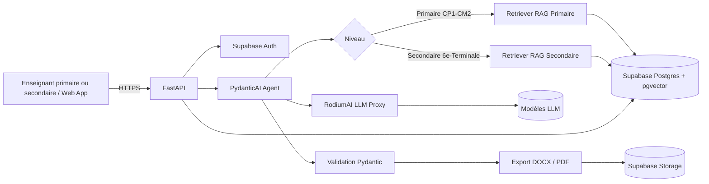

# pedago-ai

> Générateur de fiches de préparation et de guides d'exécution pédagogique assisté par IA (RAG), aligné sur l'Approche Par Compétences (APC), couvrant l'**Enseignement Primaire** (CP1 à CM2) et l'**Enseignement Secondaire** (Collège & Lycée).
> AI-assisted pedagogical lesson plan generator (RAG), aligned with the Competency-Based Approach (APC), covering **Primary School** (CP1 to CM2) and **Secondary School** (Collège & Lycée).

[](#feuille-de-route--roadmap)
[](#licence--license)

---

## Sommaire / Table of contents

1. [Français](#-version-française)
2. [English](#-english-version)

---

# 🇫🇷 Version française

## Présentation

**pedago-ai** est une plateforme SaaS qui aide les enseignants de l'**enseignement primaire** et de l'**enseignement secondaire**, en particulier en Afrique de l'Ouest (Togo en premier lieu), à produire rapidement des **fiches de préparation de leçon** et des **guides d'exécution pédagogique** conformes à l'**APC (Approche Par Compétences)**.

Le primaire est un **niveau de première classe** dans pedago-ai, au même titre que le secondaire : il dispose de ses propres référentiels, de ses propres formats de fiches et de ses propres exemples de référence.

| Niveau | Classes couvertes | Cycle |
|---|---|---|
| **Enseignement Primaire** | CP1, CP2 (Cours Préparatoire), CE1, CE2 (Cours Élémentaire), CM1, CM2 (Cours Moyen) | Cycle primaire |
| **Enseignement Secondaire** | Collège (6e à 3e), Lycée (2nde à Terminale) | Collège & Lycée |

Le système s'appuie sur une architecture **RAG (Retrieval-Augmented Generation)** :

- les **programmes officiels** et référentiels de compétences (primaire comme secondaire) sont indexés et recherchés sémantiquement ;
- des **fiches pédagogiques de référence** (few-shot) servent d'exemples de structure, de ton et de niveau ;
- un **LLM** (accédé via un proxy **RodiumAI**) génère une fiche structurée, validée par schéma, puis exportée en **DOCX** et **PDF**.

### Enseignement primaire : fonctionnalités dédiées

Le primaire est pleinement pris en charge, avec les supports officiels suivants :

- **Guides du maître** (Guides du maître CP1 à CM2) : progressions, démarches et consignes officielles.
- **Manuels officiels du primaire** : textes, supports et activités de référence par discipline (lecture, écriture, mathématiques, éveil, etc.).
- **Approches APC au primaire** : situations de vie, familles de situations et compétences de fin de cycle déclinées par classe.
- **Fiches journalières / fiches de préparation pour instituteurs** : format de fiche journalière (date, classe, discipline, compétence, objectif, étapes, évaluation) adapté à la pratique de classe du primaire.
- **Gestion de classe multigrade et effectifs importants** : consignes de différenciation, travail en groupes et temps d'activité courts adaptés aux jeunes élèves.

### Fonctionnalités clés

- Génération de **fiches de préparation** et de **fiches journalières** pour le primaire (CP1 à CM2) et le secondaire (Collège & Lycée).
- Génération de **guides d'exécution pédagogique** (séquences, consignes, gestion du temps, différenciation), pour chaque niveau.
- Alignement explicite sur les **compétences, situations de vie et savoirs** de l'APC, avec des référentiels primaire et secondaire distincts.
- Modularité **primaire / secondaire** : niveaux, classes, disciplines et référentiels configurables.
- Conformité **IESG** et paramétrage national (Togo et au-delà) via des profils de référentiel par niveau.
- Export **DOCX** et **PDF** avec mise en page institutionnelle (fiche journalière primaire ou fiche de préparation secondaire).
- Espace enseignant (compte, bibliothèque de fiches par niveau, historique de versions).
- Architecture multi-tenant prête pour une offre SaaS (écoles primaires, collèges, lycées, réseaux, formateurs).

## Architecture



### Pipeline RAG

1. **Ingestion** : parsing des programmes, guides du maître, manuels officiels du primaire, référentiels APC et fiches de référence (PDF, DOCX), découpage par niveau / classe / compétence / situation / section.
2. **Embeddings** : vectorisation des chunks et stockage dans `pgvector`, avec métadonnées (niveau `primaire` ou `secondaire`, classe, discipline, référentiel, pays, version).
3. **Récupération** : recherche hybride (similarité vectorielle + filtres métadonnées, dont le niveau) sur le référentiel ciblé.
4. **Few-shot** : sélection de 1 à 3 fiches de référence proches (même niveau, même classe ou cycle, même discipline) injectées dans le prompt.
5. **Génération** : PydanticAI produit un objet typé `LessonPlan` (fiche de préparation ou fiche journalière primaire) via le proxy RodiumAI.
6. **Validation** : schéma Pydantic, contrôle de cohérence (compétence ↔ objectifs ↔ évaluation), réessai borné.
7. **Export** : rendu DOCX / PDF à partir du modèle validé.

### Stack technique

| Couche | Technologie |
|---|---|
| API | FastAPI (Python 3.12+) |
| Agents / sorties structurées | PydanticAI |
| Base de données & vecteurs | Supabase Postgres + pgvector |
| Authentification | Supabase Auth |
| Fichiers | Supabase Storage |
| LLM | RodiumAI (proxy, modèles interchangeables) |
| Export | python-docx, WeasyPrint ou Typst (PDF) |
| Frontend | Application web (TanStack Start / React recommandé) |
| Qualité | pytest, ruff, mypy, pre-commit |
| CI/CD | GitHub Actions |

## Structure du dépôt (prévue)

```
pedago-ai/
├── apps/
│   ├── api/                  # FastAPI : routes, dépendances, configuration
│   └── web/                  # Interface enseignant (primaire et secondaire)
├── packages/
│   ├── core/                 # Domaine : LessonPlan, DailyPlanPrimaire, Competency, Level, Cycle, Classe...
│   ├── rag/                  # Ingestion, chunking, embeddings, retrieval (filtre niveau)
│   ├── agents/               # Agents PydanticAI et prompts versionnés (primaire / secondaire)
│   ├── llm/                  # Client RodiumAI (proxy) et abstraction modèle
│   └── export/               # Rendu DOCX / PDF (fiche journalière et fiche de préparation)
├── data/
│   ├── referentiels/
│   │   ├── primaire/         # Programmes, guides du maître, manuels officiels, APC CP1-CM2
│   │   └── secondaire/       # Référentiels APC Collège & Lycée
│   └── fiches_reference/
│       ├── primaire/         # Fiches journalières et fiches de préparation CP1-CM2 validées
│       └── secondaire/       # Fiches de préparation Collège & Lycée validées
├── supabase/
│   ├── migrations/           # Schéma SQL, pgvector, RLS
│   └── seed/
├── docs/                     # Architecture, ADR, guides (dont guide primaire)
├── tests/
├── .github/workflows/        # CI
├── .env.example
└── README.md
```

## Démarrage rapide

### Prérequis

- Python 3.12+ et `uv` (ou `pip`)
- Node.js 20+ et pnpm (pour l'interface web)
- Un projet Supabase (avec l'extension `vector` activée)
- Une clé API RodiumAI

### Installation

```bash
git clone https://github.com/justin2119/pedago-ai.git
cd pedago-ai
cp .env.example .env          # renseigner les variables
uv sync                       # dépendances Python
uv run pre-commit install
uv run uvicorn apps.api.main:app --reload
```

### Variables d'environnement

| Variable | Description |
|---|---|
| `SUPABASE_URL` | URL du projet Supabase |
| `SUPABASE_ANON_KEY` | Clé publique (côté client) |
| `SUPABASE_SERVICE_ROLE_KEY` | Clé serveur (jamais exposée au navigateur) |
| `SUPABASE_DB_URL` | Connexion Postgres |
| `RODIUM_API_KEY` | Clé du proxy RodiumAI |
| `RODIUM_BASE_URL` | URL du proxy RodiumAI |
| `RODIUM_MODEL` | Modèle par défaut |
| `EMBEDDING_MODEL` | Modèle d'embeddings |
| `DEFAULT_COUNTRY` | Pays de référentiel par défaut (ex. `TG`) |
| `DEFAULT_LEVEL` | Niveau par défaut : `primaire` ou `secondaire` |
| `APP_ENV` | `dev`, `staging`, `prod` |

## API (aperçu)

Toutes les routes sont préfixées par `/api/v1` et protégées par un jeton Supabase (`Authorization: Bearer <jwt>`). Le paramètre `level` accepte `primaire` ou `secondaire`.

| Méthode | Route | Description |
|---|---|---|
| `POST` | `/lesson-plans` | Génère une fiche de préparation (secondaire) ou une fiche journalière (primaire) |
| `POST` | `/execution-guides` | Génère un guide d'exécution pédagogique (primaire ou secondaire) |
| `GET` | `/lesson-plans/{id}` | Récupère une fiche |
| `PATCH` | `/lesson-plans/{id}` | Modifie une fiche (nouvelle version) |
| `GET` | `/lesson-plans/{id}/export?format=docx\|pdf` | Exporte la fiche |
| `GET` | `/referentiels?country=TG&level=primaire` | Liste les référentiels (guides du maître, manuels, APC) du primaire |
| `GET` | `/referentiels?country=TG&level=secondaire` | Liste les référentiels du secondaire |
| `GET` | `/reference-sheets?level=primaire&classe=CE1` | Liste les fiches de référence d'une classe primaire |
| `POST` | `/admin/ingest` | Ingestion d'un référentiel (rôle admin) |

### Exemple de requête : primaire (CE1)

```json
POST /api/v1/lesson-plans
{
  "country": "TG",
  "level": "primaire",
  "class": "CE1",
  "discipline": "Mathématiques",
  "competency_code": "<code tiré du référentiel primaire>",
  "topic": "Les nombres jusqu'à 100",
  "duration_minutes": 45,
  "format": "fiche_journaliere",
  "language": "fr"
}
```

### Exemple de requête : secondaire (6e)

```json
POST /api/v1/lesson-plans
{
  "country": "TG",
  "level": "secondaire",
  "class": "6e",
  "discipline": "Mathématiques",
  "competency_code": "<code tiré du référentiel secondaire>",
  "topic": "Les fractions",
  "duration_minutes": 55,
  "format": "fiche_preparation",
  "language": "fr"
}
```

### Schéma de sortie (extrait)

```python
class Level(str, Enum):
    PRIMAIRE = "primaire"       # CP1, CP2, CE1, CE2, CM1, CM2
    SECONDAIRE = "secondaire"   # Collège (6e-3e), Lycée (2nde-Terminale)

class PrimaryClass(str, Enum):
    CP1 = "CP1"  # Cours Préparatoire 1re année
    CP2 = "CP2"  # Cours Préparatoire 2e année
    CE1 = "CE1"  # Cours Élémentaire 1re année
    CE2 = "CE2"  # Cours Élémentaire 2e année
    CM1 = "CM1"  # Cours Moyen 1re année
    CM2 = "CM2"  # Cours Moyen 2e année

class LessonPlan(BaseModel):
    title: str
    level: Level                   # primaire ou secondaire, premier champ discriminant
    class_: PrimaryClass | str     # CP1-CM2 pour le primaire, 6e-Terminale pour le secondaire
    discipline: str
    competency_code: str
    objectives: list[LearningObjective]
    prerequisites: list[str]
    materials: list[str]
    phases: list[LessonPhase]      # introduction, développement, synthèse, évaluation
    assessment: AssessmentCriteria
    sources: list[SourceRef]       # traçabilité RAG (guide du maître, manuel officiel, programme)

class DailyPlanPrimaire(LessonPlan):
    """Fiche journalière pour instituteur (CP1-CM2)."""
    date: date
    cycle: Literal["CP", "CE", "CM"]
    activite_type: str             # ex. lecture, dictée, calcul, éveil
    consignes_eleves: list[str]    # consignes simples, adaptées à l'âge
```

## Modèle de données (aperçu)

- `countries`, `levels` (`primaire`, `secondaire`), `classes` (CP1 à CM2, 6e à Terminale)
- `referentials` (pays, niveau, version, IESG / profil national)
- `competencies`, `situations`, `knowledge_items` (hiérarchie APC, par niveau)
- `primary_sources` (programmes, guides du maître, manuels officiels du primaire, métadonnées : classe, discipline, année, éditeur)
- `document_chunks` (`embedding vector(...)`, métadonnées dont `level` et `class`, index HNSW)
- `reference_sheets` (fiches few-shot validées, `level`, `class`, `format` : fiche_journaliere | fiche_preparation)
- `lesson_plans` (`level`, `class`, `format`), `lesson_plan_versions`, `exports`
- `organizations`, `memberships` (multi-tenant, RLS Supabase)

## Qualité, sécurité et conformité

- Row Level Security activée sur toutes les tables utilisateur.
- Aucune donnée personnelle d'élève n'est requise ; minimisation des données (y compris pour les élèves du primaire).
- Clés API uniquement côté serveur ; secrets gérés par variables d'environnement.
- Journalisation des appels LLM (sans contenu sensible) pour audit et coûts.
- Contrôle humain : chaque fiche générée, primaire ou secondaire, est éditable et doit être validée par l'enseignant.
- Tests : unitaires (schémas, chunking, cohérence primaire / secondaire), intégration (RAG, export), évaluation de qualité des fiches (grille de relecture par niveau).

## Feuille de route / Roadmap

- **Phase 0 : Fondations** : dépôt, CI, schéma Supabase (avec niveaux et classes), ingestion d'un premier référentiel.
- **Phase 1 : MVP** : génération de fiches de préparation pour le **primaire (CP1-CM2, fiches journalières)** et le **secondaire** (une discipline), export DOCX / PDF.
- **Phase 2 : Guides d'exécution** et bibliothèque de fiches de référence, primaire et secondaire.
- **Phase 3 : Consolidation primaire / secondaire**, profils IESG par niveau, guides du maître et manuels officiels du primaire complets, paramétrage multi-pays.
- **Phase 4 : SaaS** : comptes écoles primaires et établissements secondaires, facturation, quotas, tableau de bord.
- **Phase 5 : Qualité** : boucle de retour enseignants (primaire et secondaire), évaluation automatique des fiches.

## Contribuer

Les contributions sont bienvenues : ouvrez d'abord une issue pour discuter d'un changement majeur. Respectez les conventions de commit (Conventional Commits) et lancez `uv run pytest` et `uv run ruff check` avant chaque pull request. Les contributions de référentiels primaires (guides du maître, fiches journalières validées) sont particulièrement bienvenues.

## Licence / License

Licence à définir par le titulaire du dépôt. Tant qu'aucune licence n'est publiée, tous droits sont réservés.

---

# 🇬🇧 English version

## Overview

**pedago-ai** is a SaaS platform that helps **primary school** and **secondary school** teachers, especially in West Africa (starting with Togo), produce **lesson plans** and **pedagogical execution guides** aligned with the **APC (Competency-Based Approach)**.

Primary school is a **first-class level** in pedago-ai, on equal footing with secondary: it has its own frameworks, its own lesson-plan formats and its own reference examples.

| Level | Classes covered | Cycle |
|---|---|---|
| **Primary School (Enseignement Primaire)** | CP1, CP2 (Cours Préparatoire), CE1, CE2 (Cours Élémentaire), CM1, CM2 (Cours Moyen) | Primary cycle |
| **Secondary School (Enseignement Secondaire)** | Collège (6e to 3e), Lycée (2nde to Terminale) | Collège & Lycée |

The system is built on **Retrieval-Augmented Generation (RAG)**:

- official curricula and competency frameworks (primary and secondary) are indexed and searched semantically;
- **few-shot reference sheets** provide structure, tone and level examples;
- an **LLM** (accessed through a **RodiumAI** proxy) generates a schema-validated plan, exported to **DOCX** and **PDF**.

### Primary school: dedicated support

Primary is fully supported, with these official resources:

- **Guides du maître** (teacher's guides, CP1 to CM2): progressions, methods and official instructions.
- **Official primary textbooks** (manuels officiels du primaire): texts, materials and reference activities by subject (reading, writing, mathematics, awakening/éveil, etc.).
- **APC approaches at primary level**: life situations, situation families and end-of-cycle competencies broken down by class.
- **Fiches journalières / fiches de préparation for instituteurs**: daily lesson sheets (date, class, subject, competency, objective, steps, assessment) matched to primary classroom practice.
- **Multigrade classes and large class sizes**: differentiation instructions, group work and short activity blocks suited to young learners.

### Key features

- Lesson plan and **daily sheet** generation for primary (CP1 to CM2) and secondary (Collège & Lycée).
- Pedagogical **execution guides** (sequences, instructions, timing, differentiation) for every level.
- Explicit alignment with APC **competencies, life situations and knowledge items**, with separate primary and secondary frameworks.
- **Primary / secondary** modularity: configurable levels, classes, disciplines and frameworks.
- **IESG** compliance and national configuration (Togo and beyond) through per-level framework profiles.
- **DOCX** and **PDF** export with institutional layout (primary daily sheet or secondary lesson plan).
- Teacher workspace (accounts, sheet library by level, version history).
- Multi-tenant architecture ready for a SaaS offering (primary schools, collèges, lycées, networks, trainers).

## Architecture


### RAG pipeline

1. **Ingestion**: parse curricula, teacher's guides, official primary textbooks, APC frameworks and reference sheets (PDF, DOCX), chunk by level / class / competency / situation / section.
2. **Embeddings**: vectorize chunks into `pgvector` with metadata (level `primaire` or `secondaire`, class, discipline, framework, country, version).
3. **Retrieval**: hybrid search (vector similarity + metadata filters, including level) on the target framework.
4. **Few-shot**: select 1 to 3 close reference sheets (same level, class or cycle, and discipline) for the prompt.
5. **Generation**: PydanticAI returns a typed `LessonPlan` (primary daily sheet or secondary lesson plan) through the RodiumAI proxy.
6. **Validation**: Pydantic schema plus consistency checks (competency, objectives and assessment must agree), bounded retries.
7. **Export**: DOCX / PDF rendering from the validated model.

### Tech stack

| Layer | Technology |
|---|---|
| API | FastAPI (Python 3.12+) |
| Agents / structured output | PydanticAI |
| Database & vectors | Supabase Postgres + pgvector |
| Auth | Supabase Auth |
| Files | Supabase Storage |
| LLM | RodiumAI (proxy, swappable models) |
| Export | python-docx, WeasyPrint or Typst (PDF) |
| Frontend | Web app (TanStack Start / React recommended) |
| Quality | pytest, ruff, mypy, pre-commit |
| CI/CD | GitHub Actions |

## Planned repository layout

See the French section above for the directory tree. Primary resources live under `data/referentiels/primaire/` and `data/fiches_reference/primaire/`.

## Quick start

```bash
git clone https://github.com/justin2119/pedago-ai.git
cd pedago-ai
cp .env.example .env
uv sync
uv run pre-commit install
uv run uvicorn apps.api.main:app --reload
```

Required environment variables: `SUPABASE_URL`, `SUPABASE_ANON_KEY`, `SUPABASE_SERVICE_ROLE_KEY`, `SUPABASE_DB_URL`, `RODIUM_API_KEY`, `RODIUM_BASE_URL`, `RODIUM_MODEL`, `EMBEDDING_MODEL`, `DEFAULT_COUNTRY`, `DEFAULT_LEVEL` (`primaire` or `secondaire`), `APP_ENV`.

## API (overview)

Routes are prefixed with `/api/v1` and protected by a Supabase JWT (`Authorization: Bearer <jwt>`). The `level` parameter accepts `primaire` or `secondaire`.

| Method | Route | Description |
|---|---|---|
| `POST` | `/lesson-plans` | Generate a lesson plan (secondary) or a daily sheet (primary) |
| `POST` | `/execution-guides` | Generate a pedagogical execution guide (primary or secondary) |
| `GET` | `/lesson-plans/{id}` | Fetch a plan |
| `PATCH` | `/lesson-plans/{id}` | Edit a plan (new version) |
| `GET` | `/lesson-plans/{id}/export?format=docx\|pdf` | Export a plan |
| `GET` | `/referentiels?country=TG&level=primaire` | List primary frameworks (teacher's guides, textbooks, APC) |
| `GET` | `/referentiels?country=TG&level=secondaire` | List secondary frameworks |
| `GET` | `/reference-sheets?level=primaire&class=CE1` | List reference sheets for a primary class |
| `POST` | `/admin/ingest` | Ingest a framework (admin role) |

### Example request: primary (CE1)

```json
POST /api/v1/lesson-plans
{
  "country": "TG",
  "level": "primaire",
  "class": "CE1",
  "discipline": "Mathématiques",
  "competency_code": "<code from the primary framework>",
  "topic": "Numbers up to 100",
  "duration_minutes": 45,
  "format": "fiche_journaliere",
  "language": "fr"
}
```

### Example request: secondary (6e)

```json
POST /api/v1/lesson-plans
{
  "country": "TG",
  "level": "secondaire",
  "class": "6e",
  "discipline": "Mathématiques",
  "competency_code": "<code from the secondary framework>",
  "topic": "Fractions",
  "duration_minutes": 55,
  "format": "fiche_preparation",
  "language": "fr"
}
```

### Output schema (excerpt)

```python
class Level(str, Enum):
    PRIMAIRE = "primaire"       # CP1, CP2, CE1, CE2, CM1, CM2
    SECONDAIRE = "secondaire"   # Collège (6e-3e), Lycée (2nde-Terminale)

class PrimaryClass(str, Enum):
    CP1 = "CP1"  # Cours Préparatoire 1re année
    CP2 = "CP2"  # Cours Préparatoire 2e année
    CE1 = "CE1"  # Cours Élémentaire 1re année
    CE2 = "CE2"  # Cours Élémentaire 2e année
    CM1 = "CM1"  # Cours Moyen 1re année
    CM2 = "CM2"  # Cours Moyen 2e année

class LessonPlan(BaseModel):
    title: str
    level: Level                   # primaire or secondaire, the first discriminating field
    class_: PrimaryClass | str     # CP1-CM2 for primary, 6e-Terminale for secondary
    discipline: str
    competency_code: str
    objectives: list[LearningObjective]
    prerequisites: list[str]
    materials: list[str]
    phases: list[LessonPhase]      # introduction, development, synthesis, assessment
    assessment: AssessmentCriteria
    sources: list[SourceRef]       # RAG traceability (teacher's guide, official textbook, curriculum)

class DailyPlanPrimaire(LessonPlan):
    """Daily lesson sheet for primary teachers (CP1-CM2)."""
    date: date
    cycle: Literal["CP", "CE", "CM"]
    activite_type: str             # e.g. reading, dictation, calculation, awakening
    consignes_eleves: list[str]    # simple, age-appropriate pupil instructions
```

## Data model (overview)

`countries`, `levels` (`primaire`, `secondaire`), `classes` (CP1 to CM2, 6e to Terminale), `referentials`, `competencies`, `situations`, `knowledge_items`, `primary_sources` (curricula, teacher's guides, official primary textbooks, with class, subject, year and publisher metadata), `document_chunks` (pgvector with `level` and `class` metadata, HNSW index), `reference_sheets` (`level`, `class`, `format`: fiche_journaliere | fiche_preparation), `lesson_plans` (`level`, `class`, `format`), `lesson_plan_versions`, `exports`, `organizations`, `memberships` (multi-tenant with Supabase RLS).

## Security and compliance

- Row Level Security on all user-owned tables.
- No student personal data required, including for primary pupils; data minimization by default.
- API keys stay server-side only.
- LLM calls are logged without sensitive content, for audit and cost tracking.
- Human in the loop: every generated plan, primary or secondary, is editable and must be reviewed by the teacher.

## Roadmap

- **Phase 0, Foundations**: repository, CI, Supabase schema (with levels and classes), first framework ingestion.
- **Phase 1, MVP**: lesson plans for **primary (CP1-CM2, daily sheets)** and for **secondary** (one discipline), DOCX / PDF export.
- **Phase 2**: execution guides and reference sheet library, primary and secondary.
- **Phase 3, Primary and secondary consolidation**: IESG profiles per level, complete primary teacher's guides and official textbooks, multi-country configuration.
- **Phase 4, SaaS**: primary school and secondary establishment accounts, billing, quotas, dashboard.
- **Phase 5, Quality**: teacher feedback loop (primary and secondary), automated plan evaluation.

## Contributing

Open an issue before any major change. Use Conventional Commits and run `uv run pytest` and `uv run ruff check` before each pull request. Contributions of primary resources (teacher's guides, validated daily sheets) are especially welcome.

## License

To be defined by the repository owner. Until a license is published, all rights are reserved.
