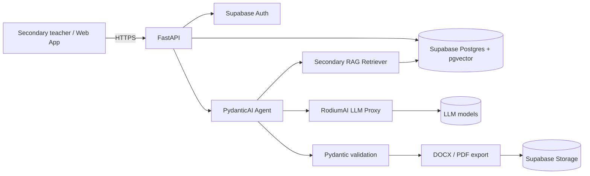

# pedago-ai

> Générateur de fiches de préparation et de guides d'exécution pédagogique assisté par IA (RAG), aligné sur l'Approche Par Compétences (APC), dédié à l'**Enseignement Secondaire** : **Collège** (Secondaire 1) et **Lycée** (Secondaire 2).
> AI-assisted pedagogical lesson plan generator (RAG), aligned with the Competency-Based Approach (APC), dedicated to **Secondary School**: **Collège** (Secondaire 1) and **Lycée** (Secondaire 2).

[](#feuille-de-route--roadmap)
[](#licence--license)

---

## Sommaire / Table of contents

1. [Français](#-version-française)
2. [English](#-english-version)

---

# 🇫🇷 Version française

## Présentation

**pedago-ai** est une plateforme SaaS qui aide les enseignants de l'**enseignement secondaire** (Collège et Lycée), en particulier en Afrique de l'Ouest (Togo en premier lieu), à produire rapidement des **fiches de préparation de leçon** et des **guides d'exécution pédagogique** conformes à l'**APC (Approche Par Compétences)**.

Le générateur est **exclusivement dédié au secondaire**. Il ne couvre pas l'enseignement primaire.

| Niveau | Classes couvertes | Séries / filières |
|---|---|---|
| **Secondaire 1 (Collège)** | 6ème, 5ème, 4ème, 3ème | Tronc commun |
| **Secondaire 2 (Lycée)** | Seconde, Première, Terminale | Seconde A, C, CD, S ; Première A4, C, D ; Terminale A4, C4, D, CD |

Le référentiel officiel de référence est constitué des **Guides d'exécution pédagogique du secondaire** (Collège & Lycée), qui définissent le cadre de l'APC pour chaque classe et chaque discipline.

Le système s'appuie sur une architecture **RAG (Retrieval-Augmented Generation)** :

- les **Guides d'exécution pédagogique du secondaire** (Collège & Lycée) et les référentiels de compétences APC sont indexés et recherchés sémantiquement ;
- des **fiches pédagogiques de référence** (fiches modèles étalons, few-shot) servent d'exemples de structure, de ton et de niveau ;
- un **LLM** (accédé via un proxy **RodiumAI**) génère une fiche structurée, validée par schéma, puis exportée en **DOCX** et **PDF**.

### Fonctionnalités clés

- Génération de **fiches de préparation** pour le Collège (6ème à 3ème) et le Lycée (Seconde, Première, Terminale), toutes séries confondues.
- Génération de **guides d'exécution pédagogique** (séquences, consignes, gestion du temps, différenciation) pour chaque classe et chaque discipline.
- Alignement explicite sur les **compétences, situations de vie et savoirs** de l'APC, avec un référentiel distinct pour le Collège et pour le Lycée.
- Prise en compte des **séries du Lycée** (Seconde A, C, CD, S ; Première A4, C, D ; Terminale A4, C4, D, CD) et des disciplines propres à chaque série.
- **Double ancrage** : contrainte légale par le Guide d'Exécution (Rulebook) et référence stylistique par les fiches modèles étalons (Few-Shot Gold Standard), voir ci-dessous.
- Conformité **IESG** et paramétrage national (Togo et au-delà) via des profils de référentiel.
- Export **DOCX** et **PDF** avec mise en page institutionnelle (fiche de préparation du secondaire).
- Espace enseignant (compte, bibliothèque de fiches par classe et série, historique de versions).
- Architecture multi-tenant prête pour une offre SaaS (collèges, lycées, réseaux, formateurs).

## Architecture


### Pipeline RAG

1. **Ingestion** : parsing des Guides d'exécution pédagogique du secondaire (Collège & Lycée), des référentiels APC et des fiches modèles étalons (PDF, DOCX), découpage par classe / série / compétence / situation / section.
2. **Embeddings** : vectorisation des chunks et stockage dans `pgvector`, avec métadonnées (niveau `secondaire`, classe, série, discipline, référentiel, pays, version).
3. **Récupération** : recherche hybride (similarité vectorielle + filtres métadonnées, dont la classe et la série) sur le référentiel ciblé.
4. **Few-shot** : sélection de 1 à 3 fiches modèles proches (même classe, même discipline, même série si applicable) injectées dans le prompt.
5. **Génération** : PydanticAI produit un objet typé `LessonPlan` (fiche de préparation) via le proxy RodiumAI.
6. **Validation** : schéma Pydantic, contrôle de cohérence (compétence ↔ objectifs ↔ évaluation), réessai borné.
7. **Export** : rendu DOCX / PDF à partir du modèle validé.

### Règle de conformité à double ancrage réglementaire et didactique : Rulebook et Few-Shot Gold Standard

Toute fiche générée (fiche de préparation ou guide d'exécution pédagogique) du secondaire DOIT se conformer strictement et cumulativement à deux ancrages :

1. **Ancrage 1, le Guide d'Exécution Pédagogique officiel : le « Rulebook »**. C'est la norme légale et pédagogique : cadre réglementaire strict, programmes officiels, APC, compétences terminales, progressions annuelles, durée, prérequis et situations d'apprentissage imposées par le ministère. Il définit ce qui est obligatoire et ce qui est interdit. Aucune fiche ne peut s'en écarter.
2. **Ancrage 2, le corpus de fiches modèles étalons : le « Few-Shot Gold Standard »**. Ce sont les fiches réelles validées par les conseillers pédagogiques et les inspecteurs IESG. Elles dictent la structure exacte, le style didactique, la formulation des objectifs pédagogiques opérationnels (OPO), et le découpage des activités enseignant / apprenant. Elles n'établissent jamais la légalité d'un contenu.

**Hiérarchie** : en cas de conflit, le Rulebook prime toujours sur le Gold Standard. Une fiche modèle qui contredit le Guide d'Exécution est écartée et signalée, même si elle est bien formatée.

**Architecture de récupération et de prompt** :

- **Étape A, Rulebook (filtre dur)** : récupération déterministe, et pas seulement sémantique, des extraits du Guide d'Exécution correspondant à la classe, à la série (le cas échéant), à la discipline et au code de compétence. Ces extraits sont injectés dans un bloc `[RULEBOOK]` présenté comme contraintes non négociables : compétence terminale, durée, prérequis, progression et situations d'apprentissage autorisées.
- **Étape B, Gold Standard (few-shot)** : 1 à 3 fiches modèles validées, sélectionnées d'abord par métadonnées (classe, série, discipline, type de fiche), puis par similarité sur le thème. Elles sont injectées dans un bloc `[GOLD_STANDARD]` présenté uniquement comme exemples de style, de structure et de vocabulaire.
- **Étape C, génération contrainte** : le LLM produit un `LessonPlan` typé. Le prompt impose que chaque élément de contenu soit justifié par une source du Rulebook, et que le style soit imité du Gold Standard. Le champ `sources` distingue les références de type `rulebook` et `gold_standard`.
- **Étape D, validation à deux passes** : (a) contrôle Rulebook : durée totale conforme au Guide, compétence et objectifs issus du référentiel, prérequis et progression respectés, situations autorisées. (b) contrôle Gold Standard : structure des phases, formulation des OPO, vocabulaire didactique et formatage conformes aux fiches modèles. Un échec en (a) déclenche un réessai borné puis un refus motivé. Un échec en (b) seul déclenche une réécriture stylistique.
- **Interdits** : ne jamais recopier mot pour mot une fiche modèle ; ne jamais utiliser une fiche modèle comme source de légalité ; ne jamais générer une fiche sans extraits Rulebook trouvés (échec explicite plutôt que génération libre).
- **Versionnement** : chaque Guide d'Exécution et chaque fiche modèle porte une version et un statut de validation. Seules les sources au statut validé sont indexées pour la production.

### Stack technique

| Couche | Technologie |
|---|---|
| API | FastAPI (Python 3.12+) |
| Agents / sorties structurées | PydanticAI |
| Base de données & vecteurs | Supabase Postgres + pgvector |
| Authentification | Supabase Auth |
| Fichiers | Supabase Storage |
| LLM | RodiumAI (proxy, modèles interchangeables) |
| Export | python-docx, WeasyPrint ou Typst (PDF) |
| Frontend | Application web (TanStack Start / React recommandé) |
| Qualité | pytest, ruff, mypy, pre-commit |
| CI/CD | GitHub Actions |

## Structure du dépôt (prévue)

```
pedago-ai/
├── apps/
│   ├── api/                  # FastAPI : routes, dépendances, configuration
│   └── web/                  # Interface enseignant (secondaire)
├── packages/
│   ├── core/                 # Domaine : LessonPlan, Competency, Classe, Serie...
│   ├── rag/                  # Ingestion, chunking, embeddings, retrieval (filtre classe / série)
│   ├── agents/               # Agents PydanticAI et prompts versionnés (secondaire)
│   ├── llm/                  # Client RodiumAI (proxy) et abstraction modèle
│   └── export/               # Rendu DOCX / PDF (fiche de préparation)
├── data/
│   ├── referentiels/
│   │   └── secondaire/       # Guides d'exécution pédagogique, référentiels APC Collège & Lycée
│   └── fiches_reference/
│       └── secondaire/       # Fiches modèles étalons Collège & Lycée validées
├── supabase/
│   ├── migrations/           # Schéma SQL, pgvector, RLS
│   └── seed/
├── docs/                     # Architecture, ADR, guides
├── tests/
├── .github/workflows/        # CI
├── .env.example
└── README.md
```

## Démarrage rapide

### Prérequis

- Python 3.12+ et `uv` (ou `pip`)
- Node.js 20+ et pnpm (pour l'interface web)
- Un projet Supabase (avec l'extension `vector` activée)
- Une clé API RodiumAI

### Installation

```bash
git clone https://github.com/justin2119/pedago-ai.git
cd pedago-ai
cp .env.example .env          # renseigner les variables
uv sync                       # dépendances Python
uv run pre-commit install
uv run uvicorn apps.api.main:app --reload
```

### Variables d'environnement

| Variable | Description |
|---|---|
| `SUPABASE_URL` | URL du projet Supabase |
| `SUPABASE_ANON_KEY` | Clé publique (côté client) |
| `SUPABASE_SERVICE_ROLE_KEY` | Clé serveur (jamais exposée au navigateur) |
| `SUPABASE_DB_URL` | Connexion Postgres |
| `RODIUM_API_KEY` | Clé du proxy RodiumAI |
| `RODIUM_BASE_URL` | URL du proxy RodiumAI |
| `RODIUM_MODEL` | Modèle par défaut |
| `EMBEDDING_MODEL` | Modèle d'embeddings |
| `DEFAULT_COUNTRY` | Pays de référentiel par défaut (ex. `TG`) |
| `DEFAULT_LEVEL` | Niveau : `secondaire` |
| `APP_ENV` | `dev`, `staging`, `prod` |

## API (aperçu)

Toutes les routes sont préfixées par `/api/v1` et protégées par un jeton Supabase (`Authorization: Bearer <jwt>`). Le paramètre `level` accepte uniquement `secondaire`.

| Méthode | Route | Description |
|---|---|---|
| `POST` | `/lesson-plans` | Génère une fiche de préparation (Collège ou Lycée) |
| `POST` | `/execution-guides` | Génère un guide d'exécution pédagogique (Collège ou Lycée) |
| `GET` | `/lesson-plans/{id}` | Récupère une fiche |
| `PATCH` | `/lesson-plans/{id}` | Modifie une fiche (nouvelle version) |
| `GET` | `/lesson-plans/{id}/export?format=docx\|pdf` | Exporte la fiche |
| `GET` | `/referentiels?country=TG&level=secondaire` | Liste les référentiels du secondaire (guides d'exécution, APC) |
| `GET` | `/reference-sheets?level=secondaire&classe=2nde&serie=C` | Liste les fiches modèles étalons d'une classe et d'une série |
| `POST` | `/admin/ingest` | Ingestion d'un référentiel (rôle admin) |

### Exemple de requête : Collège (6ème)

```json
POST /api/v1/lesson-plans
{
  "country": "TG",
  "level": "secondaire",
  "classe": "6ème",
  "discipline": "Mathématiques",
  "competency_code": "<code tiré du Guide d'exécution du Collège>",
  "topic": "Les fractions",
  "duration_minutes": 55,
  "format": "fiche_preparation",
  "language": "fr"
}
```

### Exemple de requête : Lycée (2nde, série C)

```json
POST /api/v1/lesson-plans
{
  "country": "TG",
  "level": "secondaire",
  "classe": "2nde",
  "serie": "C",
  "discipline": "Physique-Chimie",
  "competency_code": "<code tiré du Guide d'exécution du Lycée>",
  "topic": "<thème du programme>",
  "duration_minutes": 55,
  "format": "fiche_preparation",
  "language": "fr"
}
```

### Schéma de sortie (extrait)

```python
class Level(str, Enum):
    SECONDAIRE = "secondaire"     # Secondaire 1 (Collège) et Secondaire 2 (Lycée)

class Classe(str, Enum):
    SIXIEME = "6ème"
    CINQUIEME = "5ème"
    QUATRIEME = "4ème"
    TROISIEME = "3ème"
    SECONDE = "2nde"
    PREMIERE = "1ère"
    TERMINALE = "Tle"

class Serie(str, Enum):
    # Seconde
    SECONDE_A = "A"
    SECONDE_C = "C"
    SECONDE_CD = "CD"
    SECONDE_S = "S"
    # Première
    PREMIERE_A4 = "A4"
    PREMIERE_C = "C"
    PREMIERE_D = "D"
    # Terminale
    TERMINALE_A4 = "A4"
    TERMINALE_C4 = "C4"
    TERMINALE_D = "D"
    TERMINALE_CD = "CD"

class LessonPlan(BaseModel):
    title: str
    level: Level                   # toujours "secondaire"
    classe: Classe
    serie: Serie | None            # séries du Lycée uniquement, None pour le Collège
    discipline: str
    competency_code: str
    objectives: list[LearningObjective]   # OPO formulés selon les fiches modèles étalons
    prerequisites: list[str]
    materials: list[str]
    phases: list[LessonPhase]      # introduction, développement, synthèse, évaluation
    assessment: AssessmentCriteria
    sources: list[SourceRef]       # traçabilité : rulebook (guide d'exécution) et gold_standard (fiche modèle)
```

## Modèle de données (aperçu)

- `countries`, `levels` (`secondaire`), `classes` (6ème à Terminale), `series` (Lycée : Seconde A/C/CD/S, Première A4/C/D, Terminale A4/C4/D/CD)
- `referentials` (pays, niveau, version, IESG / profil national)
- `competencies`, `situations`, `knowledge_items` (hiérarchie APC, par classe et série)
- `official_sources` (Guides d'exécution pédagogique du secondaire, métadonnées : classe, série, discipline, année, éditeur)
- `document_chunks` (`embedding vector(...)`, métadonnées dont `level`, `classe` et `serie`, index HNSW)
- `reference_sheets` (fiches modèles étalons validées, `level`, `classe`, `serie`, `format` : fiche_preparation)
- `lesson_plans` (`level`, `classe`, `serie`, `format`), `lesson_plan_versions`, `exports`
- `organizations`, `memberships` (multi-tenant, RLS Supabase)

## Qualité, sécurité et conformité

- Row Level Security activée sur toutes les tables utilisateur.
- Aucune donnée personnelle d'élève n'est requise ; minimisation des données.
- Clés API uniquement côté serveur ; secrets gérés par variables d'environnement.
- Journalisation des appels LLM (sans contenu sensible) pour audit et coûts.
- Contrôle humain : chaque fiche générée est éditable et doit être validée par l'enseignant.
- Tests : unitaires (schémas, chunking, cohérence classes et séries), intégration (RAG, export), évaluation de qualité des fiches (grille de relecture par classe).

## Feuille de route / Roadmap

- **Phase 0 : Fondations** : dépôt, CI, schéma Supabase (classes et séries), ingestion du Guide d'exécution du Collège.
- **Phase 1 : MVP** : génération de fiches de préparation pour le **Collège (6ème à 3ème)** et une discipline, export DOCX / PDF.
- **Phase 2 : Lycée et guides d'exécution** : Seconde, Première, Terminale (toutes séries), guides d'exécution pédagogique et bibliothèque de fiches modèles étalons.
- **Phase 3 : Consolidation** : profils IESG, guides d'exécution et référentiels complets du Collège et du Lycée, paramétrage multi-pays.
- **Phase 4 : SaaS** : comptes établissements secondaires (collèges, lycées), facturation, quotas, tableau de bord.
- **Phase 5 : Qualité** : boucle de retour enseignants, évaluation automatique des fiches.

## Contribuer

Les contributions sont bienvenues : ouvrez d'abord une issue pour discuter d'un changement majeur. Respectez les conventions de commit (Conventional Commits) et lancez `uv run pytest` et `uv run ruff check` avant chaque pull request. Les contributions de Guides d'exécution du secondaire et de fiches modèles étalons validées sont particulièrement bienvenues.

## Licence / License

Licence à définir par le titulaire du dépôt. Tant qu'aucune licence n'est publiée, tous droits sont réservés.

---

# 🇬🇧 English version

## Overview

**pedago-ai** is a SaaS platform that helps **secondary school** teachers (Collège and Lycée), especially in West Africa (starting with Togo), produce **lesson plans** and **pedagogical execution guides** aligned with the **APC (Competency-Based Approach)**.

The generator is **exclusively dedicated to secondary school**. It does not cover primary school.

| Level | Classes covered | Streams |
|---|---|---|
| **Secondaire 1 (Collège)** | 6ème, 5ème, 4ème, 3ème | Common core |
| **Secondaire 2 (Lycée)** | Seconde, Première, Terminale | Seconde A, C, CD, S ; Première A4, C, D ; Terminale A4, C4, D, CD |

The official reference framework is the **Guides d'exécution pédagogique du secondaire** (Collège & Lycée), which define the APC framework for each class and each subject.

The system is built on **Retrieval-Augmented Generation (RAG)**:

- the secondary **Guides d'exécution pédagogique** (Collège & Lycée) and APC competency frameworks are indexed and searched semantically;
- **few-shot model sheets** (fiches modèles étalons) provide structure, tone and level examples;
- an **LLM** (accessed through a **RodiumAI** proxy) generates a schema-validated plan, exported to **DOCX** and **PDF**.

### Key features

- Lesson plan generation for Collège (6ème to 3ème) and Lycée (Seconde, Première, Terminale), all streams included.
- Pedagogical **execution guides** (sequences, instructions, timing, differentiation) for every class and subject.
- Explicit alignment with APC **competencies, life situations and knowledge items**, with separate Collège and Lycée frameworks.
- Support for **Lycée streams** (Seconde A, C, CD, S ; Première A4, C, D ; Terminale A4, C4, D, CD) and the subjects specific to each stream.
- **Dual anchoring**: legal constraint from the Guide d'Exécution (Rulebook) and stylistic reference from the model sheets (Few-Shot Gold Standard), see below.
- **IESG** compliance and national configuration (Togo and beyond) through framework profiles.
- **DOCX** and **PDF** export with institutional layout (secondary lesson plan).
- Teacher workspace (accounts, sheet library by class and stream, version history).
- Multi-tenant architecture ready for a SaaS offering (collèges, lycées, networks, trainers).

## Architecture



### RAG pipeline

1. **Ingestion**: parse the secondary Guides d'exécution pédagogique (Collège & Lycée), APC frameworks and model sheets (PDF, DOCX), chunk by class / stream / competency / situation / section.
2. **Embeddings**: vectorize chunks into `pgvector` with metadata (level `secondaire`, class, stream, subject, framework, country, version).
3. **Retrieval**: hybrid search (vector similarity + metadata filters, including class and stream) on the target framework.
4. **Few-shot**: select 1 to 3 close model sheets (same class, same subject, same stream where applicable) for the prompt.
5. **Generation**: PydanticAI returns a typed `LessonPlan` through the RodiumAI proxy.
6. **Validation**: Pydantic schema plus consistency checks (competency, objectives and assessment must agree), bounded retries.
7. **Export**: DOCX / PDF rendering from the validated model.

### Dual-anchor compliance rule: Regulatory and Didactic Double Anchor (Rulebook and Few-Shot Gold Standard)

Every generated plan (lesson plan or pedagogical execution guide) MUST strictly and cumulatively conform to two anchors:

1. **Anchor 1, the official Guide d'Exécution Pédagogique: the "Rulebook"**. This is the legal and pedagogical norm: strict regulatory framework, official curricula, APC, terminal competencies, annual progressions, duration, prerequisites and learning situations imposed by the ministry. It defines what is mandatory and what is forbidden. No plan may depart from it.
2. **Anchor 2, the corpus of model reference sheets (fiches modèles étalons): the "Few-Shot Gold Standard"**. These are real sheets validated by pedagogical advisers and IESG inspectors. They dictate the exact structure, the didactic style, the wording of learning objectives (OPO) and the split of teacher/learner activities. They never establish whether a piece of content is legal.

**Hierarchy**: in case of conflict, the Rulebook always overrides the Gold Standard. A model sheet that contradicts the Guide d'Exécution is discarded and flagged, even if well formatted.

**Retrieval and prompt architecture**:

- **Step A, Rulebook (hard filter)**: deterministic retrieval, not only semantic, of Guide d'Exécution excerpts matching class, stream (where applicable), subject and competency code. They are injected in a `[RULEBOOK]` block presented as non-negotiable constraints: terminal competency, duration, prerequisites, progression and permitted learning situations.
- **Step B, Gold Standard (few-shot)**: 1 to 3 validated model sheets, selected first by metadata (class, stream, subject, sheet type), then by topic similarity. They are injected in a `[GOLD_STANDARD]` block presented only as examples of style, structure and vocabulary.
- **Step C, constrained generation**: the LLM returns a typed `LessonPlan`. Every content element must be justified by a Rulebook source, and the style imitated from the Gold Standard. The `sources` field distinguishes `rulebook` and `gold_standard` references.
- **Step D, two-pass validation**: (a) Rulebook check: total duration, competency and objectives, prerequisites, progression and permitted situations. (b) Gold Standard check: phase structure, OPO wording, didactic vocabulary and formatting. A failure in (a) triggers bounded retries, then a reasoned refusal. A failure in (b) alone triggers a stylistic rewrite.
- **Prohibitions**: never copy a model sheet word for word; never use a model sheet as a source of legality; never generate a sheet without Rulebook excerpts (explicit failure rather than free generation).
- **Versioning**: each Guide d'Exécution and each model sheet carries a version and a validation status. Only validated sources are indexed for production.

### Tech stack

| Layer | Technology |
|---|---|
| API | FastAPI (Python 3.12+) |
| Agents / structured outputs | PydanticAI |
| Database & vectors | Supabase Postgres + pgvector |
| Authentication | Supabase Auth |
| Files | Supabase Storage |
| LLM | RodiumAI (proxy, interchangeable models) |
| Export | python-docx, WeasyPrint or Typst (PDF) |
| Frontend | Web application (TanStack Start / React recommended) |
| Quality | pytest, ruff, mypy, pre-commit |
| CI/CD | GitHub Actions |

## Planned repository layout

See the French section above for the directory tree. Secondary resources live under `data/referentiels/secondaire/` and `data/fiches_reference/secondaire/`.

## Quick start

```bash
git clone https://github.com/justin2119/pedago-ai.git
cd pedago-ai
cp .env.example .env          # fill in the variables
uv sync                       # Python dependencies
uv run pre-commit install
uv run uvicorn apps.api.main:app --reload
```

Required environment variables: `SUPABASE_URL`, `SUPABASE_ANON_KEY`, `SUPABASE_SERVICE_ROLE_KEY`, `SUPABASE_DB_URL`, `RODIUM_API_KEY`, `RODIUM_BASE_URL`, `RODIUM_MODEL`, `EMBEDDING_MODEL`, `DEFAULT_COUNTRY` (e.g. `TG`), `DEFAULT_LEVEL` (`secondaire`), `APP_ENV`.

## API (overview)

Routes are prefixed with `/api/v1` and protected by a Supabase JWT (`Authorization: Bearer <jwt>`). The `level` parameter only accepts `secondaire`.

| Method | Route | Description |
|---|---|---|
| `POST` | `/lesson-plans` | Generate a lesson plan (Collège or Lycée) |
| `POST` | `/execution-guides` | Generate a pedagogical execution guide (Collège or Lycée) |
| `GET` | `/lesson-plans/{id}` | Fetch a plan |
| `PATCH` | `/lesson-plans/{id}` | Edit a plan (new version) |
| `GET` | `/lesson-plans/{id}/export?format=docx\|pdf` | Export a plan |
| `GET` | `/referentiels?country=TG&level=secondaire` | List secondary frameworks (execution guides, APC) |
| `GET` | `/reference-sheets?level=secondaire&classe=2nde&serie=C` | List model sheets for a class and stream |
| `POST` | `/admin/ingest` | Ingest a framework (admin role) |

### Example request: Collège (6ème)

```json
POST /api/v1/lesson-plans
{
  "country": "TG",
  "level": "secondaire",
  "classe": "6ème",
  "discipline": "Mathématiques",
  "competency_code": "<code from the Collège execution guide>",
  "topic": "Fractions",
  "duration_minutes": 55,
  "format": "fiche_preparation",
  "language": "fr"
}
```

### Example request: Lycée (2nde, stream C)

```json
POST /api/v1/lesson-plans
{
  "country": "TG",
  "level": "secondaire",
  "classe": "2nde",
  "serie": "C",
  "discipline": "Physique-Chimie",
  "competency_code": "<code from the Lycée execution guide>",
  "topic": "<programme theme>",
  "duration_minutes": 55,
  "format": "fiche_preparation",
  "language": "fr"
}
```

### Output schema (excerpt)

```python
class Level(str, Enum):
    SECONDAIRE = "secondaire"     # Secondaire 1 (Collège) and Secondaire 2 (Lycée)

class Classe(str, Enum):
    SIXIEME = "6ème"
    CINQUIEME = "5ème"
    QUATRIEME = "4ème"
    TROISIEME = "3ème"
    SECONDE = "2nde"
    PREMIERE = "1ère"
    TERMINALE = "Tle"

class Serie(str, Enum):
    # Seconde
    SECONDE_A = "A"
    SECONDE_C = "C"
    SECONDE_CD = "CD"
    SECONDE_S = "S"
    # Première
    PREMIERE_A4 = "A4"
    PREMIERE_C = "C"
    PREMIERE_D = "D"
    # Terminale
    TERMINALE_A4 = "A4"
    TERMINALE_C4 = "C4"
    TERMINALE_D = "D"
    TERMINALE_CD = "CD"

class LessonPlan(BaseModel):
    title: str
    level: Level                   # always "secondaire"
    classe: Classe
    serie: Serie | None            # Lycée streams only, None for Collège
    discipline: str
    competency_code: str
    objectives: list[LearningObjective]   # OPO worded according to the model sheets
    prerequisites: list[str]
    materials: list[str]
    phases: list[LessonPhase]      # introduction, development, synthesis, assessment
    assessment: AssessmentCriteria
    sources: list[SourceRef]       # traceability: rulebook (execution guide) and gold_standard (model sheet)
```

## Data model (overview)

`countries`, `levels` (`secondaire`), `classes` (6ème to Terminale), `series` (Lycée: Seconde A/C/CD/S, Première A4/C/D, Terminale A4/C4/D/CD), `referentials` (country, level, version, IESG / national profile), `competencies`, `situations`, `knowledge_items` (APC hierarchy, per class and stream), `official_sources` (secondary execution guides, with class, stream, subject, year and publisher metadata), `document_chunks` (pgvector with `level`, `classe` and `serie` metadata, HNSW index), `reference_sheets` (validated model sheets, `level`, `classe`, `serie`, `format`: fiche_preparation), `lesson_plans` (`level`, `classe`, `serie`, `format`), `lesson_plan_versions`, `exports`, `organizations`, `memberships` (multi-tenant with Supabase RLS).

## Security and compliance

- Row Level Security on all user-owned tables.
- No student personal data required; data minimization by default.
- API keys stay server-side only.
- LLM calls are logged without sensitive content, for audit and cost tracking.
- Human in the loop: every generated plan is editable and must be reviewed by the teacher.
- Tests: unit (schemas, chunking, class and stream consistency), integration (RAG, export), plan quality evaluation (review grid per class).

## Roadmap

- **Phase 0, Foundations**: repository, CI, Supabase schema (classes and streams), ingestion of the Collège execution guide.
- **Phase 1, MVP**: lesson plans for **Collège (6ème to 3ème)** for one subject, DOCX / PDF export.
- **Phase 2, Lycée and execution guides**: Seconde, Première, Terminale (all streams), execution guides and model sheet library.
- **Phase 3, Consolidation**: IESG profiles, complete Collège and Lycée execution guides and frameworks, multi-country configuration.
- **Phase 4, SaaS**: secondary establishment accounts (collèges, lycées), billing, quotas, dashboard.
- **Phase 5, Quality**: teacher feedback loop, automatic sheet evaluation.

## Contributing

Open an issue before any major change. Use Conventional Commits and run `uv run pytest` and `uv run ruff check` before each pull request. Contributions of secondary execution guides and validated model sheets are especially welcome.

## License

License to be defined by the repository owner. Until a license is published, all rights are reserved.
